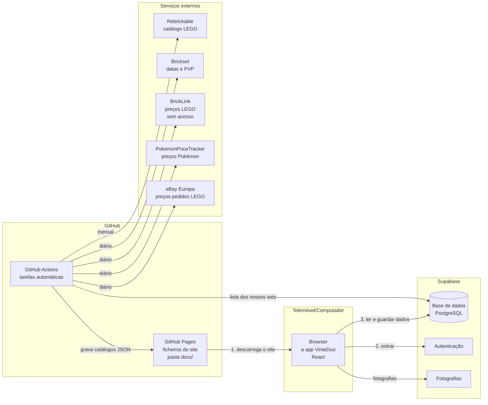
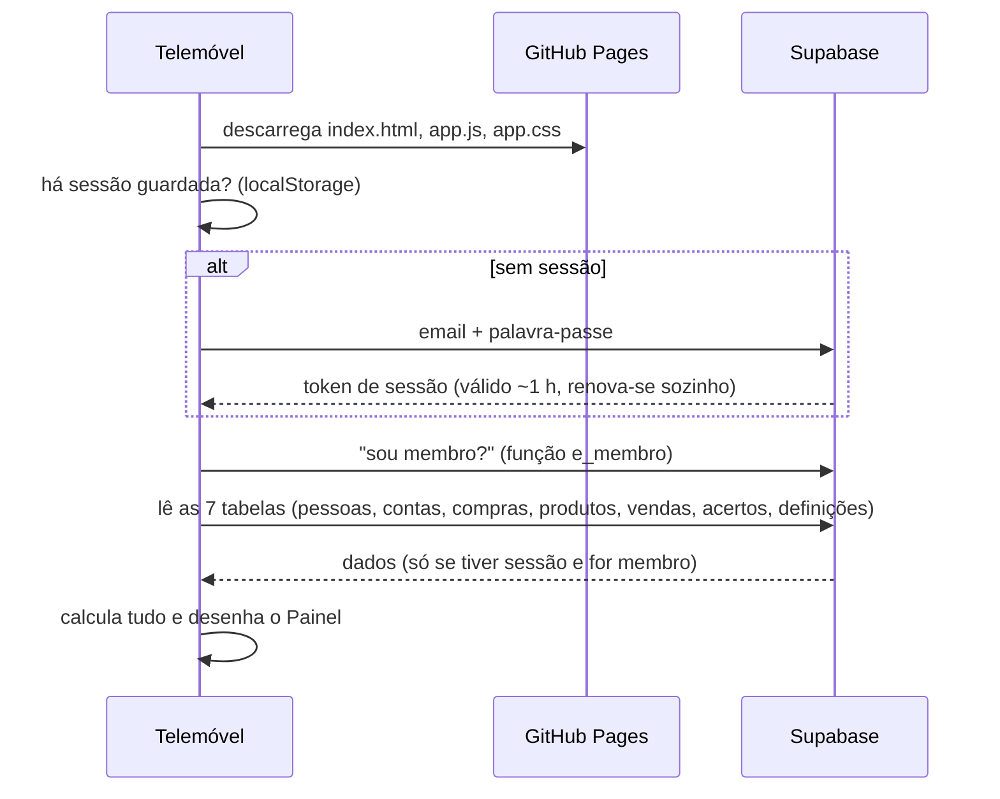
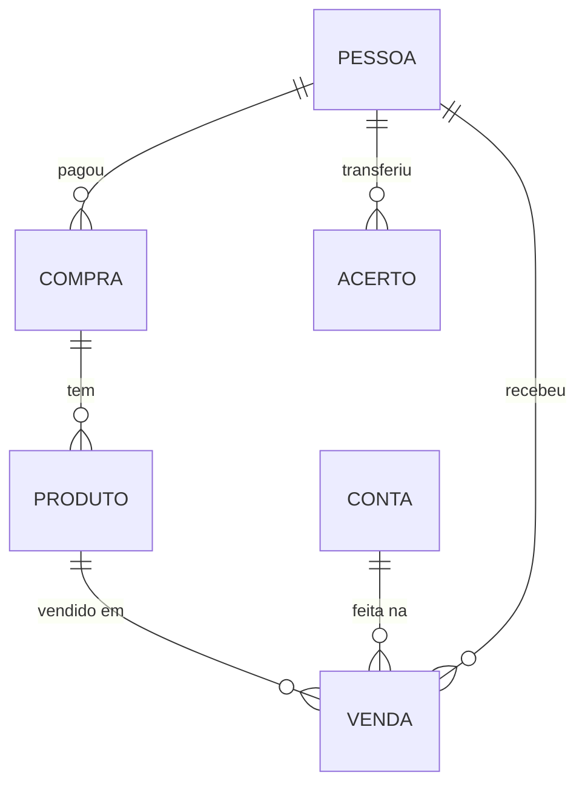
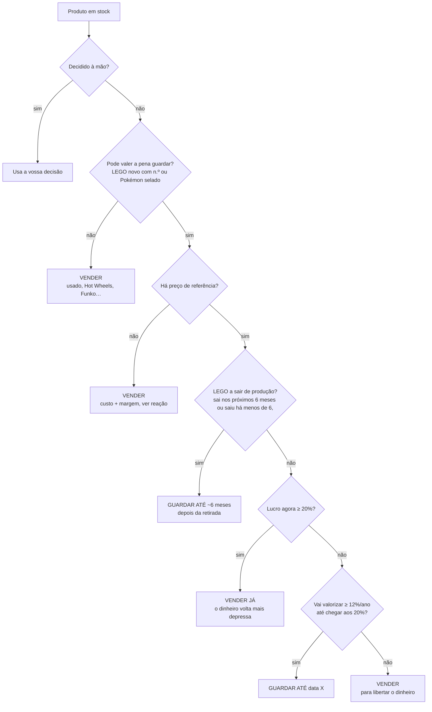

# VinteDuo

App web do Ricardo e da Cass para gerir a compra e venda de brinquedos (sobretudo LEGO e Pokémon) na Vinted. Funciona no telemóvel e no computador, os dados ficam sincronizados entre os dois, e pode ser instalada no ecrã inicial como se fosse uma app.

Além de registar compras e vendas, a VinteDuo trata o negócio **como um investimento**: mede quanto rende cada euro **e quanto tempo fica preso**, e sugere o que fazer com cada produto (vender já ou guardar até quando, e a que preço).

Este README explica **o que a app faz, como está construída e porquê**, para quem não é programador perceber as peças e como encaixam.

---

## Índice

1. [O que a app faz](#1-o-que-a-app-faz)
2. [A arquitetura numa imagem](#2-a-arquitetura-numa-imagem)
3. [Conceitos para perceber o código](#3-conceitos-para-perceber-o-código)
4. [Como os dados circulam](#4-como-os-dados-circulam)
5. [Modelo de dados](#5-modelo-de-dados)
6. [Regras do negócio e fórmulas](#6-regras-do-negócio-e-fórmulas)
7. [Investimento: análises, planos e tarefas](#7-investimento-análises-planos-e-tarefas)
8. [Dados externos (catálogo e mercado)](#8-dados-externos-catálogo-e-mercado)
9. [Segurança](#9-segurança)
10. [Mapa dos ficheiros](#10-mapa-dos-ficheiros)
11. [Como alterar a app](#11-como-alterar-a-app)
12. [Configuração inicial (feita uma vez)](#12-configuração-inicial-feita-uma-vez)
13. [Limitações conhecidas e próximos passos](#13-limitações-conhecidas-e-próximos-passos)

---

## 1. O que a app faz

| Ecrã | Para quê |
|---|---|
| **Painel** | Botões *Registar venda* e *Registar compra*, a lista **"O que fazer"** (anunciar, baixar preços, rever), os números do período, alertas de limites, acertos por fazer e vendas recentes. |
| **Produtos** | Stock e vendidos num só sítio. Filtros *Por anunciar / Anunciados / Pendentes / Vendidos* (podem combinar-se à vontade; ao abrir estão ligados Por anunciar e Anunciados). Produtos iguais aparecem agrupados com o custo médio. Cada produto mostra o plano (*vender* ou *guardar até…*). Os sets LEGO mostram o ano de retirada (Brickset). A pesquisa sugere produtos e categorias/subcategorias (ex.: *LEGO › Speed Champions*) enquanto se escreve; escolher uma categoria liga-a como filtro. |
| **Detalhe do produto** | Fotografias, imagem oficial do set, plano e preço sugerido, ciclo do set (lançamento, retirada real ou prevista e PVP, do Brickset), dados da compra, **Vendas** (deste produto e dos outros exemplares do mesmo set, com valor e lucro) e **Em stock** (outros exemplares do set por vender). Botões ✏️ (editar), 📷, *Anunciar/Retirar* e *Vendi*. |
| **Anunciar** | Escolhe a conta e o preço, e mostra o **título e a descrição prontos a copiar** para a Vinted. |
| **Vendi** | Venda rápida: só preço e conta. |
| **Acertos** | Tipo Splitwise: quem deve quanto a quem, com as transferências mínimas. |
| **Contas** | As contas da Vinted com as barras dos limites (30 vendas / 2000 € por ano). Botão ✏️ para editar cada conta. |
| **Compras** | Lista das compras. É a única forma de entrar produtos novos. |
| **Análises** | Lucro por mês, conta e categoria; **investimento** (rentabilidade por ano, dinheiro parado, valor do stock); tabela por set; lotes de compra; idade do stock; tempo até vender. |
| **Definições** | Texto dos anúncios, regras das sugestões, pessoas, listas, exportação, dados de exemplo e histórico de alterações. |

---

## 2. A arquitetura numa imagem



Há **três peças principais**:

1. **O site (frontend)**: o código da app, em React. Está guardado no GitHub e publicado pelo **GitHub Pages**, que só serve ficheiros, sem programas a correr no servidor. Quando abres a app, o browser descarrega esses ficheiros e a app corre **inteiramente no teu telemóvel**. Todas as contas (lucro, acertos, sugestões) são feitas no próprio telemóvel.
2. **A base de dados (Supabase)**: um serviço na nuvem que guarda os dados partilhados entre os dois. Dá também as contas de utilizador (email e palavra-passe) e o espaço para as fotografias.
3. **Tarefas automáticas (GitHub Actions)**: pequenos programas que o GitHub corre sozinho, de tempos a tempos. Vão buscar dados de mercado a outros serviços e gravam-nos em ficheiros JSON junto ao site. A app lê esses ficheiros como qualquer outro.

**Porque é que é assim?** É simples, grátis e seguro:
- Não há servidor nosso para manter.
- O Supabase protege os dados com regras de acesso (ver [Segurança](#9-segurança)).
- As chaves dos serviços externos nunca chegam ao telemóvel, porque ficam no GitHub e só as tarefas automáticas as usam.

---

## 3. Conceitos para perceber o código

| Conceito | O que é | Onde aparece |
|---|---|---|
| **HTML / CSS / JavaScript** | A estrutura, o aspeto e o comportamento de uma página web. | `index.html`, `src/styles.css`, todo o `src/` |
| **TypeScript** | JavaScript com **tipos**: diz-se que forma tem cada dado (por exemplo, uma `Venda` tem `preco_venda: number`), e o compilador apanha erros antes de a app correr. | Ficheiros `.ts` e `.tsx` |
| **React** | Biblioteca para construir interfaces com **componentes**: funções que recebem dados e devolvem o que desenhar. Quando os dados mudam, o React volta a desenhar só o que mudou. | Todos os `.tsx` |
| **JSX** | A forma de escrever "HTML" dentro do JavaScript: `<Campo rotulo="Preço">…</Campo>`. | `.tsx` |
| **Props** | Os parâmetros de um componente. | `function Janela(props) {…}` |
| **Estado (`useState`)** | Dados que um componente guarda e que, quando mudam, fazem o ecrã atualizar. Por exemplo, o texto escrito num campo. | Formulários |
| **Hook** | Funções do React começadas por `use…`, que dão "poderes" a um componente: `useState` (estado), `useEffect` (fazer algo ao aparecer), `useMemo` (guardar um cálculo pesado). Também criámos hooks nossos: `useDados()`, `useRota()`, `useMercado()`. | Em todo o lado |
| **Contexto / Provider** | Uma forma de partilhar dados com todos os componentes sem os passar um a um. O `DadosProvider` guarda os dados e qualquer ecrã chama `useDados()`. | `src/state.tsx` |
| **Função pura** | Recebe dados e devolve um resultado, sem mexer em mais nada. É fácil de testar. Todos os cálculos são assim. | `src/lib/calc.ts`, `plano.ts`, `investimento.ts` |
| **JSON** | Formato de texto para dados: `{"nome": "Rivendell", "preco": 360}`. | Ficheiros de catálogo, campos `jsonb` |
| **API** | Uma "porta" de um serviço para outros programas pedirem dados por HTTP. | Supabase, Brickset, BrickLink… |
| **localStorage** | Uma pequena memória do browser, que fica só naquele dispositivo. | Sessão, modo demonstração, última conta usada |
| **PWA** | *Progressive Web App*: um site que se instala no ecrã inicial e abre em ecrã inteiro. Define-se no `manifest.webmanifest`. | `public/` |
| **Compilar (build)** | Transformar o TypeScript/JSX num só ficheiro JavaScript que o browser percebe. Quem o faz é o **esbuild**. | `scripts/build.mjs` → `docs/` |
| **Git / commit / push** | O Git guarda o histórico de todas as versões do código. *Commit* é uma versão gravada; *push* envia-a para o GitHub. | — |

---

## 4. Como os dados circulam

### Ao abrir a app



A app carrega **todos os dados de uma vez**. São poucos milhares de linhas, por isso é rápido, e as contas ficam instantâneas.

### Ao registar algo (por exemplo, "Vendi")

1. O formulário chama `guardar('vendas', [venda])`, de `src/state.tsx`.
2. `guardar` compara com o que existia e prepara uma entrada no **histórico**, só com os campos que mudaram.
3. Se for um produto a mudar de estado, regista sozinho o **período de anúncio**, em `lib/anuncios.ts`.
4. Envia para o Supabase com um *upsert*: cria a linha se não existir, ou atualiza-a se existir. Depois grava o histórico.
5. Atualiza logo a memória, para o ecrã mudar sem esperar.

### Sincronização entre os dois

Não há "tempo real". A app volta a carregar os dados **quando se regressa a ela** e **de minuto a minuto**. Há também o botão ↻ para atualizar à mão.

### Modo demonstração

Em vez do Supabase, os dados ficam no `localStorage` daquele browser. O resto da app não sabe a diferença, porque fala sempre com o mesmo "contrato" (`Store`, em `src/lib/store.ts`).

---

## 5. Modelo de dados



| Tabela | O que guarda | Campos principais |
|---|---|---|
| `pessoas` | Ricardo e Cass | `nome` |
| `contas` | Contas da Vinted e os seus limites | `nome`, `utilizador_vinted`, `titular_id` (quem recebe), `limite_vendas`, `limite_valor`, `periodo` |
| `compras` | Cada compra | `data`, quem pagou (`tipo_pagamento` + `pessoa_id`), `valor_artigos`, `portes`, `distribuicao` |
| `produtos` | Cada produto (pode ter várias unidades) | `nome`, `set_numero`, `marca`, `tema`, `condicao`, `quantidade`, `preco_compra`, `custos_adicionais`, `estado`, `conta_id`, `preco_anuncio`, `fotos`, **`anuncios`** (períodos anunciado) |
| `vendas` | Cada venda | `produto_id`, `quantidade`, `data_venda`, `preco_venda`, `comissao`, `portes`, `conta_id`, `pessoa_id`, `estado`, `acertada` |
| `acertos` | Transferências já feitas entre as partes | `de`, `para`, `valor`, `data` |
| `definicoes` | Configurações (chave → JSON) | ver abaixo |
| `historico` | Todas as alterações (nunca se apaga) | `quando`, `utilizador`, `tabela`, `acao`, `antes`, `depois` |
| `membros` | Emails autorizados | `email` |

**Estados de um produto:** `por_anunciar` → `anunciado` → `vendido`. Também pode ficar `devolvido` ou `cancelado`.
**Estados de uma venda:** `pendente` (feita mas não concluída), `concluida`, `cancelada` ou `devolvida`.

### O que está em `definicoes`

Para não ter de mudar a estrutura da base de dados a cada nova ideia, as configurações ficam todas nesta tabela, como pares **chave → valor JSON**:

| Chave | Conteúdo |
|---|---|
| `condicoes`, `temas`, `marcas`, `metodos_pagamento` | Listas de opções dos formulários |
| `nomes_mantidos` | Sets em que preferimos o nosso nome ao oficial |
| `vendas_externas` | Vendas feitas nas contas mas fora do negócio (contam só para os limites) |
| `vendas_fora_limites` | Vendas da app que a Vinted não conta (por exemplo, canceladas lá mas pagas por fora) |
| `modelo_anuncio` | Texto dos anúncios (título, descrição para novos e para usados) |
| `regras_plano` | Regras das sugestões vender/guardar |
| `planos` | Decisões manuais (vender / guardar até…) por set e condição |
| `tarefas_adiadas` | Tarefas escondidas até uma data |
| `pokemon_ids` | Associação manual de produtos Pokémon ao TCGplayer |
| `token_mercado` | Código que deixa a tarefa automática ler a lista dos nossos sets |

---

## 6. Regras do negócio e fórmulas

### Custos e lucro (`src/lib/calc.ts`)

```
custo unitário  = (preço de compra + custos adicionais) ÷ quantidade
líquido         = preço de venda − comissão − portes − outros custos
lucro da venda  = líquido − custo unitário × unidades vendidas
```

- Numa compra com vários produtos, o valor divide-se **em partes iguais** ou **pelo preço de cada um**. Os portes repartem-se em proporção ao preço, e os cêntimos que sobram vão para o último produto, para a soma bater certo (`distribuirCompra`).
- Só contam para o lucro as vendas **pendentes** e **concluídas**.

### Acertos (`src/lib/acertos.ts`)

Funciona como o Splitwise. Quando uma venda fica **concluída**, quem recebeu o dinheiro:

1. **Devolve o custo** a quem pagou o produto: uma pessoa, a conta conjunta, ou as duas pessoas em partes iguais.
2. **Passa o lucro para a conta conjunta.**

Cada parte fica com um saldo, e as transferências já feitas abatem a esse saldo. No fim, a app **simplifica** as dívidas para o menor número de transferências. Vendas com `acertada = true` são de contas antigas já resolvidas e não entram.

### Limites das contas (`usoConta`)

A Vinted e as Finanças (diretiva **DAC7**) acompanham quem faz **30 vendas ou 2000 € por ano civil**. Para cada conta, a app soma:

- as vendas da app nessa conta, no ano;
- \+ as **vendas fora da app** (`vendas_externas`), como livros ou roupa vendidos na mesma conta;
- − as vendas que a Vinted não conta (`vendas_fora_limites`).

O aviso aparece aos 80%.

### Texto dos anúncios (`src/lib/anuncio.ts`)

É um modelo com marcadores, como `Lego {numero} {nome}`, que são trocados pelos dados do produto. Há um texto para produtos novos e outro para usados, editáveis em Definições.

---

## 7. Investimento: análises, planos e tarefas

A ideia central: **um lucro de 20% em 1 mês vale muito mais do que 20% em 2 anos**, porque o dinheiro volta e pode ser reinvestido. Por isso a app mede sempre o **tempo**.

### Tempo anunciado (`src/lib/anuncios.ts`)

Sempre que um produto muda para *anunciado*, abre-se um período, e quando deixa de estar fecha-se, com o motivo (vendido ou retirado). As mudanças de preço ficam registadas dentro do período. Tudo fica no campo `produtos.anuncios`. Assim, com o tempo, vai dar para saber quanto demora cada tipo de produto a vender **depois de anunciado** e se baixar o preço ajuda.

### Análises de investimento (`src/lib/investimento.ts`)

```
rentabilidade por ano = lucro ÷ (custo × dias com o dinheiro preso ÷ 365)
dinheiro parado       = custo do stock, e há quantos dias está parado (média pesada pelo custo)
valor estimado        = unidades em stock × preço de mercado (BrickLink, eBay com desconto, TCGplayer ou a nossa venda média)
```

Conta **o que já foi vendido**, que dá a rentabilidade real, **e o que está em stock**, que dá o dinheiro parado e o valor estimado.

### Planos e tarefas (`src/lib/plano.ts`)

Para cada produto em stock, a app decide um **plano**:



- **Preço de referência**, por esta ordem: as nossas vendas do mesmo produto nos últimos 2 anos (as do último ano pesam mais) → BrickLink → **eBay** (mediana dos anúncios de novos na Europa, menos 10% por serem preços pedidos) → TCGplayer (Pokémon) → PVP da Brickset: com 20% de desconto se ainda estiver à venda na LEGO, ou, se já foi retirado, o PVP valorizado desde a retirada com as mesmas taxas das regras (no máximo o dobro do PVP).
- **Subida da retirada ("pop"):** um set LEGO perto da retirada (sai nos próximos 6 meses ou saiu há menos de 6, pela data real do Brickset) guarda-se até ~6 meses depois da retirada, mesmo que já dê lucro e seja qual for o valor do set. O plano mostra uma estimativa do valor nessa data (nunca menor do que o PVP valorizado), só como informação. Os 2 números de meses editam-se em Definições. Análises mais finas por set (previsões de valor) precisam de dados como os da API do BrickEconomy.
- **Valorização esperada** (taxas fixas iguais para todos os sets, editáveis em Definições; não é uma previsão por set):
  - **LEGO:** ~0% enquanto a LEGO ainda o vende; ~20%/ano nos 2 anos depois de ser retirado; ~7%/ano depois disso.
  - **Pokémon selado:** ~15%/ano.
  - A data de retirada vem da Brickset (real, ou prevista para os sets ainda à venda). Sem ela, estima-se como ano de lançamento + 2,5 anos.
- **Preço sugerido** = referência + 8% (margem para negociar), nunca abaixo de custo + 5%.
- **Baixar o preço:** ao fim de **60 dias** anunciado sem mudar de preço, sugere baixar 7%.

Todos estes números estão em **Definições → Regras das sugestões** e podem ser mudados.

A lista **"O que fazer"** no Painel junta as tarefas: *Anunciar X a Y €*, *Baixar X para Y €* e *Rever X* (quando acaba um prazo de guardar escolhido por vocês). Cada tarefa pode ser **adiada** 14 dias. Tocar no título "O que fazer" minimiza ou maximiza a lista (fica lembrado em cada dispositivo).

**Anuncia-se uma unidade de cada vez.** Se já há um produto igual anunciado (mesmo n.º de set ou nome), as outras unidades não aparecem como "Anunciar" até essa ser vendida.

---

## 8. Dados externos (catálogo e mercado)

Estes dados são preparados por **GitHub Actions** (pasta `.github/workflows/`). A app só lê os ficheiros JSON que elas geram.

| Ficheiro | Gerado por | Quando | Conteúdo |
|---|---|---|---|
| `public/catalogo-sets.json` | `scripts/catalogo.py` | Mensal | ~26 mil sets LEGO (Rebrickable): nome, ano, tema. Preenche o formulário ao escrever o n.º do set. |
| `public/mercado-sets.json` | `scripts/mercado.py` | Diário (5h43 UTC) | **eBay**: mediana dos preços pedidos por cada set nosso, novo, nas lojas eBay da Alemanha, França, Espanha e Itália. **PokemonPriceTracker**: preço dos produtos Pokémon selados (TCGplayer, EUA). **Brickset**: lançamento, retirada (real ou prevista), PVP. **BrickLink**: preparado, sem acesso. |

### As chaves (segredos)

Ficam em **GitHub → Settings → Secrets and variables → Actions**. Se uma faltar, essa fonte é ignorada e os dados anteriores mantêm-se.

| Segredo | Para quê |
|---|---|
| `VINTEDUO_TOKEN` | Deixa a tarefa pedir ao Supabase **só** a lista dos nossos n.º de set e nomes Pokémon, através das funções `sets_mercado` e `pokemon_mercado`. Não dá acesso a mais nada. |
| `BRICKSET_API_KEY` | Brickset (grátis, pedida em brickset.com). |
| `BRICKLINK_CONSUMER_KEY`, `BRICKLINK_CONSUMER_SECRET`, `BRICKLINK_TOKEN`, `BRICKLINK_TOKEN_SECRET` | BrickLink. **Sem acesso:** a API só está disponível para vendedores com loja na BrickLink. |
| `POKEMONPRICETRACKER_API_KEY` | PokemonPriceTracker (plano grátis: 100 pedidos por dia). |
| `EBAY_CLIENT_ID`, `EBAY_CLIENT_SECRET` | eBay Browse API: o *App ID* e o *Cert ID* do "Production keyset" de uma conta grátis em developer.ebay.com. |

Para correr a tarefa à mão: **Actions → "Atualizar dados de mercado" → Run workflow**.

**Pokémon:** os nossos nomes são curtos ("ETB"), por isso a pesquisa por nome pode encontrar o produto errado. Para evitar isso:

- O resultado só é aceite automaticamente se for **inequívoco**: todas as palavras que identificam o nosso produto aparecem no nome encontrado (palavras genéricas como "box" ou "elite" não contam) e nenhum outro resultado empata.
- Se houver dúvida, a tarefa guarda até 3 **candidatos**, e no detalhe do produto aparece **"Qual destes é?"**. A escolha fica em `pokemon_ids` e o preço passa a contar logo.
- Se não for nenhum, em *"Não é nenhum destes"* cola-se o endereço da página do produto no TCGplayer.
- Um preço automático absurdo face ao custo (mais de 4× ou menos de ¼) é ignorado.
- Produtos em espanhol ou português não existem no TCGplayer, que é só inglês. Associar à versão inglesa dá uma referência aproximada.

---

## 9. Segurança

- **Só os membros veem os dados.** Todas as tabelas têm **RLS** (*Row Level Security*): regras na própria base de dados que só deixam ler e escrever a quem tem **sessão iniciada** e cujo email está na tabela **`membros`**. Estão definidas em `supabase/schema.sql`.
- **A chave do Supabase no código é pública por natureza** (*publishable*). Sozinha não dá acesso a nada, por causa das regras acima. A chave secreta (`service_role`) e a palavra-passe da base de dados **nunca** entram no código.
- **O repositório é público**, por isso as chaves dos serviços externos ficam só nos segredos do GitHub.
- **Histórico imutável:** a tabela `historico` só aceita linhas novas. Nem a app consegue alterar ou apagar o histórico.
- **Fotografias privadas:** o bucket `fotos` só é acessível com sessão.
- **Apagar pede sempre confirmação.**

---

## 10. Mapa dos ficheiros

```
index.html                  página base: um <div id="root"> onde o React desenha a app
src/
  main.tsx                  ponto de entrada: arranca o React
  App.tsx                   entrar vs. app; menu; escolhe o ecrã pela rota
  router.ts                 rotas com "#" (#/produtos, #/analises…)
  config.ts                 URL e chave pública do Supabase
  state.tsx                 dados globais (useDados), guardar/apagar, histórico, sincronização
  styles.css                todo o aspeto visual (claro e escuro)
  lib/                      lógica sem interface (funções puras, testáveis)
    types.ts                forma de cada tipo de dado (= colunas da base de dados)
    calc.ts                 custos, lucro, limites, estatísticas, lotes, idade do stock
    acertos.ts              saldos e transferências tipo Splitwise
    investimento.ts         rentabilidade anualizada, dados de mercado (useMercado)
    plano.ts                planos vender/guardar, preço sugerido, tarefas
    anuncio.ts              texto dos anúncios
    anuncios.ts             registo automático do tempo anunciado
    store.ts                "contrato" de dados: Supabase ou demonstração
    supabase.ts             ligação ao Supabase (sessão, tabelas, fotografias)
    format.ts               formatar euros, datas, números
    csv.ts                  exportar para CSV (Excel em português)
    sample.ts               dados de exemplo
  components/               peças de interface
    ui.tsx                  janela, campos, listas, cartões, fotografias, logo…
    acoes.tsx               abrir janelas a partir de qualquer ecrã (+ botão voltar)
    planos.tsx              "O que fazer", etiquetas e janela do plano, preço Pokémon
    catalogo.ts             sugestões e catálogo oficial de sets
    FormCompra.tsx          registar compra (entrada de produtos)
    FormProduto.tsx         editar produto
    FormVenda.tsx           venda completa
    FormVendi.tsx           venda rápida
    FormAnunciar.tsx        anunciar/retirar + texto para a Vinted
    FormConta.tsx           conta da Vinted e limites
    DetalheProduto.tsx      detalhe de um produto
    PesquisaProdutos.tsx    pesquisa de Produtos com sugestões e filtro de categoria
    CabecalhoProdutos.tsx   topo e filtros do ecrã Produtos
    Graficos.tsx            gráficos de barras simples
  pages/                    ecrãs
    Painel.tsx  Inventario.tsx (Produtos)  Compras.tsx  Contas.tsx  Acertos.tsx
    Analises.tsx  Definicoes.tsx  ReverNomes.tsx  Entrar.tsx
public/                     ficheiros copiados tal como estão (ícones, manifest, catálogos JSON)
docs/                       versão publicada (gerada; não editar à mão)
scripts/
  build.mjs                 compila src/ para docs/ com o esbuild
  catalogo.py               gera o catálogo de sets (GitHub Action mensal)
  mercado.py                gera os dados de mercado (GitHub Action diária)
.github/workflows/          as GitHub Actions (catalogo.yml, mercado.yml)
supabase/schema.sql         tabelas, regras de segurança e funções da base de dados
tests/                      testes automáticos dos cálculos
CLAUDE.md                   notas e regras para o Claude quando altera a app
```

Cada ficheiro de código começa com um comentário que explica para que serve e como funciona.

---

## 11. Como alterar a app

### No computador

É preciso o [Node.js](https://nodejs.org), versão 20 ou mais recente.

```bash
npm install        # instala as bibliotecas (uma vez)
npm run dev        # abre em http://localhost:5173 e atualiza ao gravar
npm test           # corre os testes dos cálculos
npm run typecheck  # confirma os tipos do TypeScript
npm run build      # gera a versão publicada em docs/
```

O CSS e o JS levam no endereço um código que muda a cada compilação (`?v=…`), para o telemóvel não usar uma cópia antiga. Os ícones (separador do browser, ecrã principal e `manifest`) levam um código calculado a partir do conteúdo dos ficheiros de ícone, por isso só mudam quando o logótipo muda.

### Publicar uma alteração

1. `npm test` e `npm run build`.
2. Fazer commit (incluindo a pasta `docs/`) e push para o `main`.
3. O GitHub Pages publica em 1–2 minutos. No telemóvel, basta fechar e voltar a abrir a app.

### Com o Claude

O ficheiro `CLAUDE.md` tem a visão do projeto e as regras que o Claude segue sempre. Por exemplo: nunca mexer nos acertos sem pedido, comentar o código de forma didática e manter este README atualizado.

---

## 12. Configuração inicial (feita uma vez)

### Base de dados no Supabase

1. No Supabase, abre o projeto → **SQL Editor** → **New query**.
2. Abre [`supabase/schema.sql`](supabase/schema.sql) e **substitui `EMAIL_1@exemplo.com` e `EMAIL_2@exemplo.com` pelos vossos emails**. Depois cola tudo e carrega em **Run**.
3. Em **Authentication → Users → Add user → Create new user**, cria um utilizador para cada um (email + palavra-passe, com **Auto Confirm User** ativado).
4. Em **Authentication → Sign In / Providers**, desativa **Allow new users to sign up**.

Para acrescentar alguém, junta o email à tabela `membros` e cria-lhe o utilizador.

### Publicar no GitHub Pages

No repositório: **Settings → Pages → Source: Deploy from a branch → Branch: `main`, pasta `/docs`**.
A app fica em `https://ricardomarquescardoso.github.io/gestao-vinted/`.

### Instalar no telemóvel

- **iPhone (Safari):** Partilhar → **Adicionar ao ecrã principal**.
- **Android (Chrome):** menu ⋮ → **Instalar app**.

### Experimentar sem dados reais

No ecrã de entrada: **Experimentar com dados de exemplo**. Os dados ficam só nesse browser.

---

## 13. Limitações conhecidas e próximos passos

- **Sincronização:** não é instantânea. A app atualiza de minuto a minuto e ao voltar a ela.
- **Preços Pokémon:** vêm do TCGplayer, que é o mercado dos EUA. A API do Cardmarket não aceita novos pedidos, e um plano pago da PokemonPriceTracker daria preços do Cardmarket.
- **Sugestões LEGO:** sem a BrickLink, não há preços de **venda** reais de mercado. A referência são as nossas vendas, os anúncios do eBay (preços pedidos) e o PVP da Brickset (valorizado se o set já foi retirado). Os valores das regras devem ser afinados com os dados reais de tempo anunciado.
- **Próximo passo planeado:** sugerir **compras** a partir das promoções do dia, comparando o preço da promoção com o histórico de vendas, a valorização esperada e o tempo até vender.
