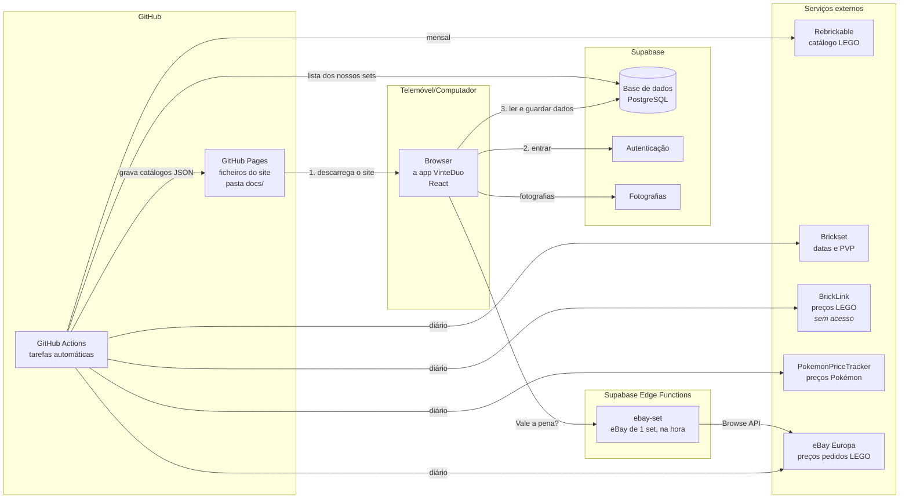
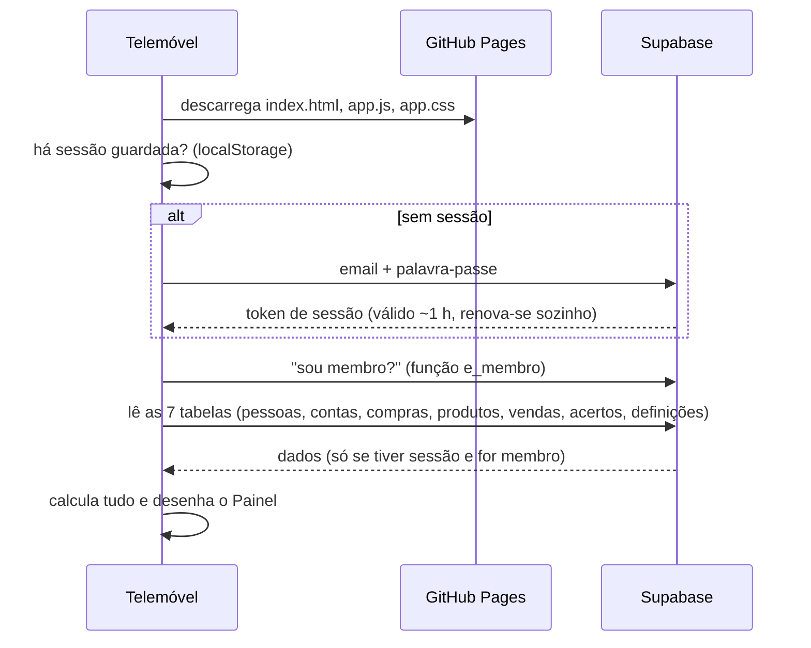
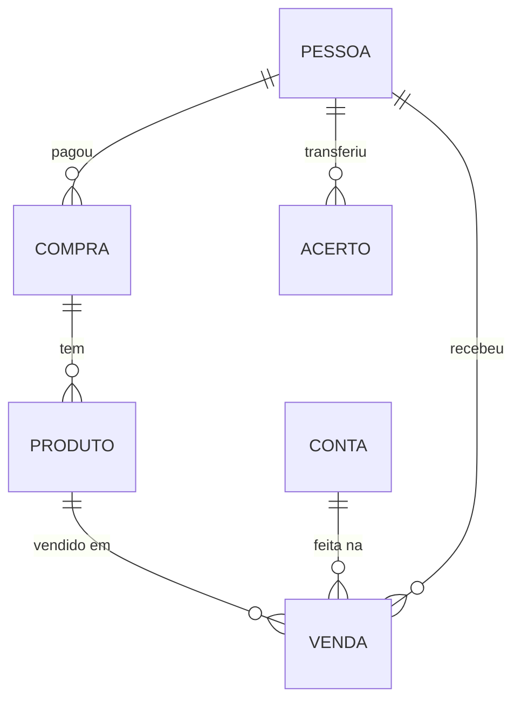
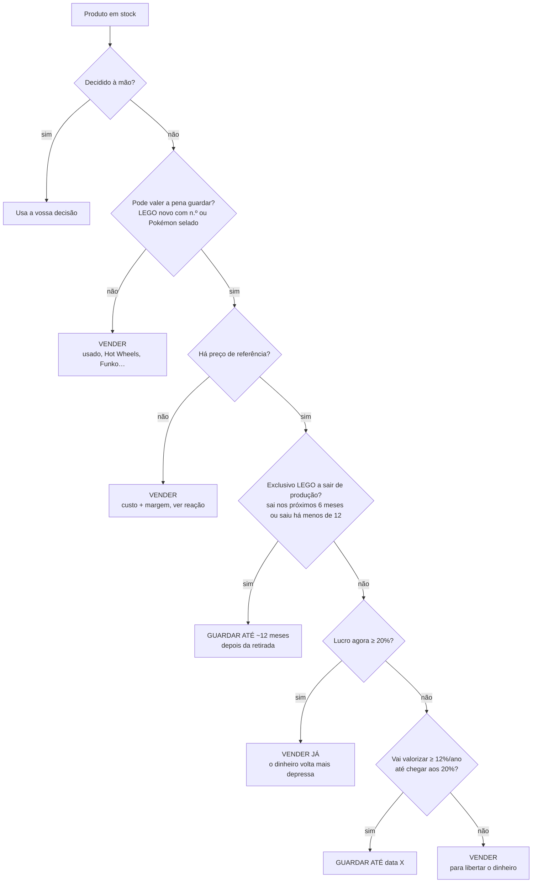

# VinteDuo

App web do Ricardo e da Cass para gerir a compra e venda de brinquedos (sobretudo LEGO e Pokémon) na Vinted. Funciona no telemóvel e no computador, os dados ficam sincronizados entre os dois, e pode ser instalada no ecrã inicial como se fosse uma app.

Além de registar compras e vendas, a VinteDuo trata o negócio **como um investimento**: mede quanto rende cada euro **e quanto tempo fica preso**, e sugere o que fazer com cada produto (vender já ou guardar até quando, e a que preço).

Este README explica **o que a app faz, como está construída e porquê**, para quem não é programador perceber as peças e como encaixam.

---

## Índice

1. [O que a app faz](#1-o-que-a-app-faz)
2. [A arquitetura numa imagem](#2-a-arquitetura-numa-imagem)
3. [Conceitos para perceber o código](#3-conceitos-para-perceber-o-código)
4. [Como os dados circulam](#4-como-os-dados-circulam)
5. [Modelo de dados](#5-modelo-de-dados)
6. [Regras do negócio e fórmulas](#6-regras-do-negócio-e-fórmulas)
7. [Investimento: análises, planos e tarefas](#7-investimento-análises-planos-e-tarefas)
8. [Dados externos (catálogo e mercado)](#8-dados-externos-catálogo-e-mercado)
9. [Segurança](#9-segurança)
10. [Mapa dos ficheiros](#10-mapa-dos-ficheiros)
11. [Como alterar a app](#11-como-alterar-a-app)
12. [Configuração inicial (feita uma vez)](#12-configuração-inicial-feita-uma-vez)
13. [Limitações conhecidas e próximos passos](#13-limitações-conhecidas-e-próximos-passos)

---

## 1. O que a app faz

| Ecrã | Para quê |
|---|---|
| **Painel** | Botões *Registar venda* e *Registar compra*, a lista **"O que fazer"**, as **promoções recebidas** de outra app (com quantos sets compensam) (anunciar, baixar preços, rever), os números do período, alertas de limites, acertos por fazer e vendas recentes. |
| **Produtos** | Stock e vendidos num só sítio. Filtros *Por anunciar / Anunciados / Vendidos* (podem combinar-se à vontade; ao abrir estão ligados Por anunciar e Anunciados). Produtos iguais aparecem agrupados com o custo médio. Cada produto mostra uma **bolinha tipo semáforo** e a próxima ação numa só linha (ver *Sinal dos produtos*). Por baixo do nome, só a categoria e o número do set (sem a palavra "Set"); a retirada do set fica no detalhe do produto. A pesquisa sugere produtos e categorias/subcategorias (ex.: *LEGO › Speed Champions*) enquanto se escreve; escolher uma categoria liga-a como filtro. |
| **Detalhe do produto** | Fotografias (com **Partilhar** e **Descarregar**, ver *Fotografias* abaixo), imagem oficial do set (com links para o site da LEGO, a Brickset e a **pesquisa do set na Vinted**) (ou do produto no TCGplayer, nos Pokémon), plano e preço sugerido, ciclo do set (lançamento, retirada real ou prevista e PVP, do Brickset), dados da compra, **Vendas** (deste produto e dos outros exemplares do mesmo set, com valor e lucro) e **Em stock** (outros exemplares do set por vender). Botões ✏️ (editar), 📷, *Anunciar/Retirar* e *Vendi*. |
| **Anunciar** | Escolhe a conta e o preço, e mostra o **título e a descrição prontos a copiar** para a Vinted e as **fotografias para partilhar** (ex.: diretamente para a app da Vinted) ou descarregar. |
| **Vendi** | Venda rápida: só preço e conta. |
| **Acertos** | Tipo Splitwise: quem deve quanto a quem, com as transferências mínimas. |
| **Contas** | As contas da Vinted com as barras dos limites (30 vendas / 2000 € por ano). Botão ✏️ para editar cada conta. |
| **Compras** | Lista das compras. É a única forma de entrar produtos novos. Tem o atalho **Vale a pena?**. |
| **Vale a pena?** | Antes de comprar: escreve-se só o n.º do set e a app mostra por quanto se vende, em quantos dias, e **até que preço compensa comprar e quantas unidades** (bom / muito bom / oportunidade rara), a diversificar. Tem links para ver o set na Vinted e nos vendidos do eBay. Está na barra de baixo do telemóvel, no lugar onde estavam as Contas (que passaram para *Mais*). |
| **Análises** | Lucro por mês, conta e categoria; **investimento** (rentabilidade por ano, dinheiro parado, valor do stock); tabela por set; lotes de compra; idade do stock; tempo até vender. |
| **Definições** | Texto dos anúncios, regras das sugestões, pessoas, listas, exportação, dados de exemplo e histórico de alterações. |

---

## 2. A arquitetura numa imagem



Há **três peças principais**:

1. **O site (frontend)**: o código da app, em React. Está guardado no GitHub e publicado pelo **GitHub Pages**, que só serve ficheiros, sem programas a correr no servidor. Quando abres a app, o browser descarrega esses ficheiros e a app corre **inteiramente no teu telemóvel**. Todas as contas (lucro, acertos, sugestões) são feitas no próprio telemóvel.
2. **A base de dados (Supabase)**: um serviço na nuvem que guarda os dados partilhados entre os dois. Dá também as contas de utilizador (email e palavra-passe) e o espaço para as fotografias.
3. **Tarefas automáticas (GitHub Actions)**: pequenos programas que o GitHub corre sozinho, de tempos a tempos. Vão buscar dados de mercado a outros serviços e gravam-nos em ficheiros JSON junto ao site. A app lê esses ficheiros como qualquer outro.

**Porque é que é assim?** É simples, grátis e seguro:
- Não há servidor nosso para manter.
- O Supabase protege os dados com regras de acesso (ver [Segurança](#9-segurança)).
- As chaves dos serviços externos nunca chegam ao telemóvel, porque ficam no GitHub e só as tarefas automáticas as usam.

---

## 3. Conceitos para perceber o código

| Conceito | O que é | Onde aparece |
|---|---|---|
| **HTML / CSS / JavaScript** | A estrutura, o aspeto e o comportamento de uma página web. | `index.html`, `src/styles.css`, todo o `src/` |
| **TypeScript** | JavaScript com **tipos**: diz-se que forma tem cada dado (por exemplo, uma `Venda` tem `preco_venda: number`), e o compilador apanha erros antes de a app correr. | Ficheiros `.ts` e `.tsx` |
| **React** | Biblioteca para construir interfaces com **componentes**: funções que recebem dados e devolvem o que desenhar. Quando os dados mudam, o React volta a desenhar só o que mudou. | Todos os `.tsx` |
| **JSX** | A forma de escrever "HTML" dentro do JavaScript: `<Campo rotulo="Preço">…</Campo>`. | `.tsx` |
| **Props** | Os parâmetros de um componente. | `function Janela(props) {…}` |
| **Estado (`useState`)** | Dados que um componente guarda e que, quando mudam, fazem o ecrã atualizar. Por exemplo, o texto escrito num campo. | Formulários |
| **Hook** | Funções do React começadas por `use…`, que dão "poderes" a um componente: `useState` (estado), `useEffect` (fazer algo ao aparecer), `useMemo` (guardar um cálculo pesado). Também criámos hooks nossos: `useDados()`, `useRota()`, `useMercado()`. | Em todo o lado |
| **Contexto / Provider** | Uma forma de partilhar dados com todos os componentes sem os passar um a um. O `DadosProvider` guarda os dados e qualquer ecrã chama `useDados()`. | `src/state.tsx` |
| **Função pura** | Recebe dados e devolve um resultado, sem mexer em mais nada. É fácil de testar. Todos os cálculos são assim. | `src/lib/calc.ts`, `plano.ts`, `investimento.ts` |
| **JSON** | Formato de texto para dados: `{"nome": "Rivendell", "preco": 360}`. | Ficheiros de catálogo, campos `jsonb` |
| **API** | Uma "porta" de um serviço para outros programas pedirem dados por HTTP. | Supabase, Brickset, BrickLink… |
| **localStorage** | Uma pequena memória do browser, que fica só naquele dispositivo. | Sessão, modo demonstração, última conta usada |
| **PWA** | *Progressive Web App*: um site que se instala no ecrã inicial e abre em ecrã inteiro. Define-se no `manifest.webmanifest`. | `public/` |
| **Compilar (build)** | Transformar o TypeScript/JSX num só ficheiro JavaScript que o browser percebe. Quem o faz é o **esbuild**. | `scripts/build.mjs` → `docs/` |
| **Git / commit / push** | O Git guarda o histórico de todas as versões do código. *Commit* é uma versão gravada; *push* envia-a para o GitHub. | — |

---

## 4. Como os dados circulam

### Ao abrir a app



A app carrega **todos os dados de uma vez**. São poucos milhares de linhas, por isso é rápido, e as contas ficam instantâneas.

### Ao registar algo (por exemplo, "Vendi")

1. O formulário chama `guardar('vendas', [venda])`, de `src/state.tsx`.
2. `guardar` compara com o que existia e prepara uma entrada no **histórico**, só com os campos que mudaram.
3. Se for um produto a mudar de estado, regista sozinho o **período de anúncio**, em `lib/anuncios.ts`.
4. Envia para o Supabase com um *upsert*: cria a linha se não existir, ou atualiza-a se existir. Depois grava o histórico.
5. Atualiza logo a memória, para o ecrã mudar sem esperar.

### Sincronização entre os dois

Não há "tempo real". A app volta a carregar os dados **quando se regressa a ela** e **de minuto a minuto**. Há também o botão ↻ para atualizar à mão.

### Modo demonstração

Em vez do Supabase, os dados ficam no `localStorage` daquele browser. O resto da app não sabe a diferença, porque fala sempre com o mesmo "contrato" (`Store`, em `src/lib/store.ts`).

---

## 5. Modelo de dados



| Tabela | O que guarda | Campos principais |
|---|---|---|
| `pessoas` | Ricardo e Cass | `nome` |
| `contas` | Contas da Vinted e os seus limites | `nome`, `utilizador_vinted`, `titular_id` (quem recebe), `limite_vendas`, `limite_valor`, `periodo` |
| `compras` | Cada compra | `data`, quem pagou (`tipo_pagamento` + `pessoa_id`), `valor_artigos`, `portes`, `distribuicao` |
| `produtos` | Cada produto (pode ter várias unidades) | `nome`, `set_numero`, `marca`, `tema`, `condicao`, `quantidade`, `preco_compra`, `custos_adicionais`, `estado`, `conta_id`, `preco_anuncio`, `fotos`, **`anuncios`** (períodos anunciado) |
| `vendas` | Cada venda | `produto_id`, `quantidade`, `data_venda`, `preco_venda`, `comissao`, `portes`, `conta_id`, `pessoa_id`, `estado`, `acertada` |
| `acertos` | Transferências já feitas entre as partes | `de`, `para`, `valor`, `data` |
| `definicoes` | Configurações (chave → JSON) | ver abaixo |
| `historico` | Todas as alterações (nunca se apaga) | `quando`, `utilizador`, `tabela`, `acao`, `antes`, `depois` |
| `membros` | Emails autorizados | `email` |

**Estados de um produto:** `por_anunciar` → `anunciado` → `vendido`. Também pode ficar `devolvido` ou `cancelado`.
**Estados de uma venda:** `concluida`, `cancelada` ou `devolvida`. Não há estado intermédio: na Vinted um produto passa diretamente de anunciado a vendido, por isso uma venda nova fica logo `concluida`.

### O que está em `definicoes`

Para não ter de mudar a estrutura da base de dados a cada nova ideia, as configurações ficam todas nesta tabela, como pares **chave → valor JSON**:

| Chave | Conteúdo |
|---|---|
| `condicoes`, `temas`, `marcas`, `metodos_pagamento` | Listas de opções dos formulários |
| `nomes_mantidos` | Sets em que preferimos o nosso nome ao oficial |
| `vendas_externas` | Vendas feitas nas contas mas fora do negócio (contam só para os limites) |
| `vendas_fora_limites` | Vendas da app que a Vinted não conta (por exemplo, canceladas lá mas pagas por fora) |
| `modelo_anuncio` | Texto dos anúncios (título, descrição para novos e para usados) |
| `regras_plano` | Regras das sugestões vender/guardar |
| `planos` | Decisões manuais (vender / guardar até…) por set e condição |
| `tarefas_adiadas` | Tarefas escondidas até uma data |
| `pokemon_ids` | Associação manual de produtos Pokémon ao TCGplayer |
| `token_mercado` | Código que deixa a tarefa automática ler a lista dos nossos sets |
| `token_promocoes` | Código secreto para outra app enviar promoções (função `receber_promocao`) |
| `promocoes` | Promoções recebidas de outra app (as 50 mais recentes) |
| `promocoes_vistas` | Promoções dispensadas do Painel |
| `sets_avaliar` | Sets que acompanhamos sem os ter (botão *Acompanhar* do **Vale a pena?**): a tarefa diária vai buscar o eBay deles |

---

## 6. Regras do negócio e fórmulas

### Custos e lucro (`src/lib/calc.ts`)

```
custo unitário  = (preço de compra + custos adicionais) ÷ quantidade
líquido         = preço de venda − comissão − portes − outros custos
lucro da venda  = líquido − custo unitário × unidades vendidas
```

- Numa compra com vários produtos, o valor divide-se **em partes iguais** ou **pelo preço de cada um**. Os portes repartem-se em proporção ao preço, e os cêntimos que sobram vão para o último produto, para a soma bater certo (`distribuirCompra`).
- Só contam para o lucro as vendas **concluídas**.

### Acertos (`src/lib/acertos.ts`)

Funciona como o Splitwise. Quando uma venda fica **concluída**, quem recebeu o dinheiro:

1. **Devolve o custo** a quem pagou o produto: uma pessoa, a conta conjunta, ou as duas pessoas em partes iguais.
2. **Passa o lucro para a conta conjunta.**

Cada parte fica com um saldo, e as transferências já feitas abatem a esse saldo. No fim, a app **simplifica** as dívidas para o menor número de transferências. Vendas com `acertada = true` são de contas antigas já resolvidas e não entram.

### Limites das contas (`usoConta`)

A Vinted e as Finanças (diretiva **DAC7**) acompanham quem faz **30 vendas ou 2000 € por ano civil**. Para cada conta, a app soma:

- as vendas da app nessa conta, no ano;
- \+ as **vendas fora da app** (`vendas_externas`), como livros ou roupa vendidos na mesma conta;
- − as vendas que a Vinted não conta (`vendas_fora_limites`).

O aviso aparece aos 80%.

### Texto dos anúncios (`src/lib/anuncio.ts`)

É um modelo com marcadores, como `Lego {numero} {nome}`, que são trocados pelos dados do produto. Há um texto para produtos novos e outro para usados, editáveis em Definições.

---

## 7. Investimento: análises, planos e tarefas

A ideia central: **um lucro de 20% em 1 mês vale muito mais do que 20% em 2 anos**, porque o dinheiro volta e pode ser reinvestido. Por isso a app mede sempre o **tempo**.

### Tempo anunciado (`src/lib/anuncios.ts`)

Sempre que um produto muda para *anunciado*, abre-se um período, e quando deixa de estar fecha-se, com o motivo (vendido ou retirado). As mudanças de preço ficam registadas dentro do período. Tudo fica no campo `produtos.anuncios`. Assim, com o tempo, vai dar para saber quanto demora cada tipo de produto a vender **depois de anunciado** e se baixar o preço ajuda.

### Análises de investimento (`src/lib/investimento.ts`)

```
rentabilidade por ano = lucro ÷ (custo × dias com o dinheiro preso ÷ 365)
dinheiro parado       = custo do stock, e há quantos dias está parado (média pesada pelo custo)
valor estimado        = unidades em stock × preço de mercado (BrickLink, eBay com desconto, TCGplayer ou a nossa venda média)
```

Conta **o que já foi vendido**, que dá a rentabilidade real, **e o que está em stock**, que dá o dinheiro parado e o valor estimado.

### Planos e tarefas (`src/lib/plano.ts`)

Para cada produto em stock, a app decide um **plano**:



- **Preço de referência**, por esta ordem: as nossas vendas do mesmo produto nos últimos 2 anos (as do último ano pesam mais) → BrickLink → **eBay** (mediana dos anúncios de novos na Europa, com o **desconto real medido nas nossas vendas**, ver abaixo) → TCGplayer (Pokémon) → PVP da Brickset: com 20% de desconto se ainda estiver à venda na LEGO, ou, se já foi retirado, o PVP valorizado desde a retirada com as mesmas taxas das regras (no máximo o dobro do PVP).
- **Subida da retirada ("pop"), só nos exclusivos LEGO:** um set **vendido só pela LEGO** (Brickset: "LEGO exclusive") perto da retirada (sai nos próximos 6 meses ou saiu há menos de 12, pela data real do Brickset) guarda-se até ~12 meses depois da retirada, mesmo que já dê lucro. Os sets vendidos nas lojas normais **não** se guardam por esta regra: vendem-se quando o lucro compensa. O plano mostra uma estimativa do valor nessa data, só como informação. Os 2 números de meses editam-se em Definições. Sets especiais que não são exclusivos (ex.: minifigura muito procurada) decidem-se à mão.
  - **Porquê (out/2026):** analisaram-se 10 sets no BrickEconomy, comparando com o **PVP europeu** (o BrickEconomy usa o mercado dos EUA e o preço de lá, mais baixo). Os sets das lojas quase não subiram depois da retirada, mesmo os grandes: Lamborghini Countach 0%, Triwizard −10%, Dobby e Batmobile +15–25% e depois parados, Disney Duos +25%. Na Vinted recebe-se ~0,85 do valor do BrickEconomy (variando entre 0,6 e 1,3). Nos exclusivos LEGO não há promoções nas lojas a encher o mercado, e a subida demora 12–18 meses a construir-se. Nessa altura passaram de 18 para 4 os produtos guardados (828 € → 443 €).
- **Valorização esperada** (taxas fixas iguais para todos os sets, editáveis em Definições; não é uma previsão por set):
  - **LEGO:** ~0% enquanto a LEGO ainda o vende; ~5%/ano nos 2 anos depois de ser retirado; ~3%/ano depois disso (medido em out/2026; antes eram 20% e 7%, otimistas demais).
  - **Pokémon selado:** ~15%/ano.
  - A data de retirada vem da Brickset (real, ou prevista para os sets ainda à venda). Sem ela, estima-se como ano de lançamento + 2,5 anos.
- **Desconto real sobre o eBay** (`calibrarEbay` em `src/lib/investimento.ts`): os preços do eBay são pedidos, e nós vendemos na Vinted. Para cada set que já vendemos, calcula-se *preço a que vendemos ÷ preço pedido no eBay* **na mesma altura**; a mediana desses rácios (por set) dá a percentagem que costumamos conseguir, e o desconto é o resto. Comparar uma venda antiga com o eBay de hoje enganava: se o set foi retirado entretanto, o eBay subiu e parecia que vendemos barato (out/2026: 0,57 nesses sets contra 0,67 nos que não mudaram de fase). Por isso cada venda compara-se com:
  1. o **histórico do eBay** (`ebay_hist` em `mercado-sets.json`) mais próximo da data da venda, até 30 dias de diferença;
  2. se ainda não há histórico dessa altura (começou a 28/10/2026), o eBay de hoje, **só se o set ainda está à venda na LEGO** (não mudou de fase desde a venda);
  3. senão, a venda não entra.

  Usam-se as vendas de sets novos do último ano (ou dos últimos 2 anos, se houver poucas) e é preciso pelo menos 10 sets; com menos, usa-se a regra de reserva "Desconto sobre o eBay" (37%). **Ajusta-se sozinho a cada venda**: cada venda nova entra logo, comparada com o eBay do dia em que foi feita. As Definições mostram quantos sets vieram do histórico e quantos do eBay de hoje. Em out/2026: vendemos a ~63% do eBay (22 sets comparáveis) → desconto de 37%. O mesmo desconto entra no valor estimado do stock e no **Vale a pena?**.
- **Preço sugerido** = referência + 8% (margem para negociar), nunca abaixo de custo + 5%.
- **Baixar o preço:** ao fim de **60 dias** anunciado sem mudar de preço, sugere baixar 7%.

Todos estes números estão em **Definições → Regras das sugestões** e podem ser mudados.

A lista **"O que fazer"** no Painel junta as tarefas: *Anunciar X a Y €*, *Baixar X para Y €* e *Rever X* (quando acaba um prazo de guardar escolhido por vocês). Cada tarefa pode ser **adiada** 14 dias. Tocar no título "O que fazer" minimiza ou maximiza a lista (fica lembrado em cada dispositivo).

**Sinal dos produtos** (`sinais()` em `src/lib/plano.ts`, desenhado por `SinalProduto` em `planos.tsx`): em vez de várias etiquetas, cada cartão tem uma bolinha de cor e uma linha com a próxima ação. A cor responde a "tenho de fazer alguma coisa?" e usa as mesmas tarefas do "O que fazer":

| Cor | Quando | Texto |
|---|---|---|
| 🟢 Verde | Anunciado há até 60 dias, ou outra unidade igual já está anunciada | *Anunciado há 12 dias* / *Outro igual já anunciado* |
| 🟡 Amarelo | Há uma ação: anunciar (plano vender) ou baixar o preço | *Anunciar a 89 €* / *Baixar para 38 €* |
| 🔵 Azul | Guardado de propósito, ou a tarefa de anunciar foi adiada | *Guardar até jul/27* / *Anunciar adiado* |
| 🔴 Vermelho | Anunciado há mais de 60 dias (`DIAS_PARADO`), ou acabou o prazo de guardar escolhido por vocês | *74 dias · baixar para 39 €* / *Prazo de guardar acabou* |
| ⚪ Cinzento | Já não está em stock | *Vendido* / *Cancelado* / *Devolvido* |

Um grupo de produtos iguais mostra o sinal da unidade mais urgente. Ao passar o rato aparece o porquê (o motivo do plano ou da tarefa). Na importação do Excel os anunciados ficaram todos com data de anúncio 27/10/2026, por isso os vermelhos só começam a aparecer com o tempo.

**Anuncia-se uma unidade de cada vez.** Se já há um produto igual anunciado (mesmo n.º de set ou nome), as outras unidades não aparecem como "Anunciar" até essa ser vendida.

### Vale a pena? Até que preço comprar, e quantas unidades (`src/lib/avaliar.ts`, ecrã `pages/Avaliar.tsx`)

Escreve-se só o n.º do set. A app calcula (`precosCompra`):

```
preço de venda esperado = a primeira que existir de:
    1. as nossas vendas deste set (as mesmas dos planos)
    2. eBay: mediana pedida AGORA (função ebay-set) ou a do dia × a % a que costumamos vender (calibrarEbay)
    3. PVP × a % do PVP a que costumamos vender (calibrarPvp), à parte para sets à venda e retirados
dias até vender        = mediana (compra → venda) das nossas vendas deste set; senão do tema (≥ 5 vendas); senão de todas
preço máximo (escalão) = venda esperada ÷ (1 + margem do escalão), e nunca mais do que venda − 5 €
```

| Escalão | Lucro mínimo (regra) | Unidades a ter (contando o stock) |
|---|---|---|
| 🟡 Bom | 20% (`margemVender`) | 1 |
| 🟢 Muito bom | 40% (`margemCompraOtima`) | até 2 |
| 🟢 Oportunidade rara | 75% (`margemCompraRara`) | até 3 |

Acima do preço do escalão **Bom** não compensa comprar.

**Diversificar (decisão do Ricardo):** acumular muitas unidades do mesmo set só compensa numa oportunidade de outro mundo. Anuncia-se uma unidade de cada vez, por isso cada unidade a mais demora mais a vender e prende dinheiro. Além das unidades por escalão, **nunca se fica com mais de 10% do dinheiro em stock num só set** (`maxCapitalPorSet`); se ainda não há nenhuma unidade, deixa-se sempre comprar 1. As três regras editam-se em Definições. Cada linha mostra também o lucro e quanto rende por ano a esse preço (com várias unidades, o dinheiro fica preso em média (n + 1) ÷ 2 vezes o tempo de uma venda).

Mostra ainda quantas vendas cabem este ano nas contas ativas (30 por conta) e de onde vem o preço de venda, com o erro típico de cada fonte.

**Limitação:** os dias até vender vêm das datas de compra, que na importação da folha ficaram no dia 1 do mês, e incluem sets guardados de propósito. Servem só como ordem de grandeza. Quando houver dados suficientes do tempo **anunciado** (desde 27/10/2026), passa a usar-se esse.

(`avaliarCompra` continua disponível para avaliar um preço concreto: lucro, margem, rentabilidade e veredicto.)

#### Promoção da loja (modo do mesmo ecrã, `components/AvaliarPromocao.tsx`, `avaliarPromocao`)

Para promoções de lojas grandes (Fnac, Continente, Toys R Us…), em que se parte sempre do **PVP**: escreve-se o desconto (ex.: 25%) e cola-se a lista de sets — os números, ou o **texto copiado da página da loja** (selecionar tudo → copiar → colar); `extrairSets` encontra os n.º de set no meio do texto (ignora preços, códigos de barras e números que não são sets). Para cada set:

```
preço na promoção  = PVP (Brickset, LEGO Alemanha) × (1 − desconto)
escalão / unidades = os mesmos do modo "Um set" (bom / muito bom / oportunidade rara, a diversificar)
compensa a partir de = 1 − (preço máximo do escalão "bom" ÷ PVP)
```

Os que compensam aparecem primeiro, pelo **lucro seguro** (o lucro mesmo que a venda fique abaixo do esperado pelo erro típico da fonte). **Diversificar por tema:** no máximo 2 compras do mesmo tema por promoção. Mostra o total a gastar, descarrega para Excel (CSV) e tem o botão *Acompanhar os sem eBay*.

A app **não abre o link da loja**: o browser não deixa uma página ler outros sites, e fazê-lo num servidor seria recolha automática (termos de uso).

Com os dados de out/2026: nos 124 sets que já tivemos, compensa comprar a partir de **~44% de desconto** (mediana; metade entre 35% e 50%). A 25%, só 12 compensavam, quase todos sets que vendemos bem acima do PVP.

**Porquê esta ordem e o PVP medido — o "teste com o passado" (out/2026).** Para cada uma das 102 vendas de LEGO com data, calculou-se o que cada fonte teria previsto e comparou-se com o preço real:

| Fonte | Vendas | Erro típico | Desvio | Acerta a ±20% |
|---|---|---|---|---|
| As nossas vendas anteriores | 40 | 11% | −3% | 85% |
| eBay × 0,64 | 102 | 12% | +3% | 70% |
| PVP (como nos planos) | 102 | 20% | +18% | 54% |

E, a comparar o preço de venda com o PVP pela fase do set na data da venda: **ainda à venda ~0,73 × PVP; retirado há < 1 ano ~0,79; 1–2 anos ~0,80; > 2 anos ~0,83** (os planos assumem 0,80 / 1,10 / 1,33 / 1,48). Ou seja, **nas nossas vendas quase não houve subida depois da retirada**. Ressalvas: poucos sets retirados (32 vendas), vendemos depressa (mediana ~30 dias) e os que valorizam podem estar guardados. Por isso o **Vale a pena?** usa o rácio medido; os **planos ainda não foram alterados** (seria preciso mostrar primeiro o impacto no stock).

**Links:** *Ver na Vinted* abre a pesquisa `lego <n.º>` na Vinted, mais baratos primeiro e só novos (com e sem etiquetas); no telemóvel abre na app da Vinted, se estiver instalada. *Vendidos no eBay* abre os anúncios vendidos no eBay.de. São só links que nós abrimos à mão: **a app não lê nada da Vinted nem do site do eBay** (termos de uso).

---

## 8. Dados externos (catálogo e mercado)

Estes dados são preparados por **GitHub Actions** (pasta `.github/workflows/`). A app só lê os ficheiros JSON que elas geram.

| Ficheiro | Gerado por | Quando | Conteúdo |
|---|---|---|---|
| `public/catalogo-sets.json` | `scripts/catalogo.py` | Mensal | ~26 mil sets LEGO (Rebrickable): nome, ano, tema. Preenche o formulário ao escrever o n.º do set. |
| `public/mercado-sets.json` | `scripts/mercado.py` | Diário (5h43 UTC) | **eBay**: mediana dos preços pedidos por cada set nosso, novo, nas lojas eBay da Alemanha, França, Espanha e Itália. Guarda também o **histórico do eBay** (`ebay_hist`: uma linha por set quando o preço muda, ou pelo menos uma por semana). **PokemonPriceTracker**: preço dos produtos Pokémon selados (TCGplayer, EUA). **Brickset**: lançamento, retirada (real ou prevista), PVP. **BrickLink**: preparado, sem acesso. |

### eBay na hora (função `ebay-set` no Supabase)

O ecrã **Vale a pena?** precisa do eBay de sets que talvez nunca tivemos, e a tarefa diária só vai buscar os nossos. Por isso há uma **Edge Function** no Supabase (`supabase/functions/ebay-set/index.ts`), um pequeno programa que corre na nuvem do Supabase quando é chamado:

1. A app chama-a com o token da sessão; a função confirma com `e_membro` que quem pede é membro (senão recusa).
2. Usa as chaves do eBay **guardadas nos segredos do Supabase** (não no código nem no telemóvel) e faz a mesma pesquisa da tarefa diária (novos, preço fixo, eBay DE/FR/ES/IT, n.º do set no título, sem partes).
3. Devolve a mediana do preço pedido e o n.º de anúncios. A app aplica o mesmo desconto real (`calibrarEbay`).

Se as chaves ainda não estiverem no Supabase, a função responde `sem_chaves` e a app usa o eBay da tarefa diária. Nesse caso, o botão **Acompanhar** junta o set a `definicoes.sets_avaliar`, e a função SQL `sets_mercado` passa a incluí-lo na lista da tarefa diária.

### Promoções enviadas por outra app (função `receber_promocao`)

Uma app externa (ex.: a do Ricardo que tira a lista de LEGO em promoção no Continente) pode enviar a lista sozinha. A VinteDuo mostra-a no Painel com quantos sets compensam; tocar abre o **Vale a pena? → Promoção da loja** já preenchido (`#/avaliar/promo/<id>`).

- **Como enviar:** `POST https://hunuxphczekrxilfmthb.supabase.co/rest/v1/rpc/receber_promocao`, com os cabeçalhos `apikey: <chave publishable>` e `Content-Type: application/json`, e o corpo:

  ```json
  { "token": "<código secreto>", "loja": "Continente",
    "texto": "LEGO 75375 Millennium Falcon 63,74 €\nLEGO 42151 Bugatti 37,49 €",
    "desconto": 25, "valida_ate": "2026-11-10" }
  ```

  `texto` é a lista como se cola na app, com ou sem preços. Em alternativa, `itens`: `[{"set": "75375", "preco": 63.74}]`. São obrigatórios `token`, `loja` e `texto` ou `itens`; `desconto` (% sobre o PVP, para os sets sem preço) e `valida_ate` são opcionais. Resposta: `{"ok": true, "id": "…"}`.
- **O código secreto** está em `definicoes.token_promocoes`, e vê-se e copia-se em **Definições → Receber promoções de outra app**, onde também estão estas instruções. Só deixa entregar promoções: não dá acesso a mais nada. Nunca vai para o código nem para o chat.
- **Onde ficam:** em `definicoes.promocoes`, as 50 mais recentes, e cada receção fica no histórico. O Painel mostra as dos últimos 7 dias, ou as que ainda estão dentro de `valida_ate`, até serem dispensadas.
- **Preços:** cada set fica com o preço mais baixo da sua linha e das linhas seguintes sem outro set (nas páginas copiadas, o preço costuma vir por baixo do nome). Um preço absurdo face ao PVP (< 20% ou > 105%) é ignorado e usa-se o desconto. Código: `extrairItens` (`lib/avaliar.ts`), `lib/promocoes.ts`, `components/CartaoPromocoes.tsx`.

### As chaves (segredos)

Ficam em **GitHub → Settings → Secrets and variables → Actions**. Se uma faltar, essa fonte é ignorada e os dados anteriores mantêm-se.

| Segredo | Para quê |
|---|---|
| `VINTEDUO_TOKEN` | Deixa a tarefa pedir ao Supabase **só** a lista dos nossos n.º de set e nomes Pokémon, através das funções `sets_mercado` e `pokemon_mercado`. Não dá acesso a mais nada. |
| `BRICKSET_API_KEY` | Brickset (grátis, pedida em brickset.com). |
| `BRICKLINK_CONSUMER_KEY`, `BRICKLINK_CONSUMER_SECRET`, `BRICKLINK_TOKEN`, `BRICKLINK_TOKEN_SECRET` | BrickLink. **Sem acesso:** a API só está disponível para vendedores com loja na BrickLink. |
| `POKEMONPRICETRACKER_API_KEY` | PokemonPriceTracker (plano grátis: 100 pedidos por dia). |
| `EBAY_CLIENT_ID`, `EBAY_CLIENT_SECRET` | eBay Browse API: o *App ID* e o *Cert ID* do "Production keyset" de uma conta grátis em developer.ebay.com. |

**Segredos do Supabase** (*Edge Functions → Secrets*): `EBAY_CLIENT_ID` e `EBAY_CLIENT_SECRET`, os mesmos valores do GitHub, para a função `ebay-set`. Os segredos do GitHub não se conseguem ler de volta, por isso copiam-se de novo a partir de developer.ebay.com.

Para correr a tarefa à mão: **Actions → "Atualizar dados de mercado" → Run workflow**.

Se o eBay recusar as chaves, a tarefa não falha: grava o motivo em `ebay_erro` dentro de `mercado-sets.json` (a resposta do eBay, que nunca inclui as chaves) e as outras fontes atualizam-se na mesma. As chaves são lidas sem espaços à volta.

**Pokémon:** os nossos nomes são curtos ("ETB"), por isso a pesquisa por nome pode encontrar o produto errado. Para evitar isso:

- O resultado só é aceite automaticamente se for **inequívoco**: todas as palavras que identificam o nosso produto aparecem no nome encontrado (palavras genéricas como "box" ou "elite" não contam) e nenhum outro resultado empata.
- Se houver dúvida, a tarefa guarda até 3 **candidatos**, e no detalhe do produto aparece **"Qual destes é?"**. A escolha fica em `pokemon_ids` e o preço passa a contar logo.
- Se não for nenhum, em *"Não é nenhum destes"* cola-se o endereço da página do produto no TCGplayer.
- Um preço automático absurdo face ao custo (mais de 4× ou menos de ¼) é ignorado.
- Produtos em espanhol ou português não existem no TCGplayer, que é só inglês. Associar à versão inglesa dá uma referência aproximada.

**Imagens Pokémon:** um produto Pokémon sem fotografia nossa mostra a imagem do produto no TCGplayer (`tcgplayer-cdn.tcgplayer.com/product/<id>_200w.jpg`, ou `_in_1000x1000.jpg` no detalhe), tal como os LEGO mostram a do Brickset. A imagem não é guardada, é o browser que a vai buscar. Só aparece quando já se sabe qual é o produto: associação automática inequívoca (e com preço não absurdo) ou escolhida em "Qual destes é?", onde os candidatos também mostram a miniatura. Se a imagem não carregar, fica o ícone ⚡. Código: `idTcgPokemon` e `urlImagemTcg` em `src/lib/investimento.ts`, `useImagemReferencia` em `src/components/ui.tsx`.

---

## 9. Segurança

- **Só os membros veem os dados.** Todas as tabelas têm **RLS** (*Row Level Security*): regras na própria base de dados que só deixam ler e escrever a quem tem **sessão iniciada** e cujo email está na tabela **`membros`**. Estão definidas em `supabase/schema.sql`.
- **A chave do Supabase no código é pública por natureza** (*publishable*). Sozinha não dá acesso a nada, por causa das regras acima. A chave secreta (`service_role`) e a palavra-passe da base de dados **nunca** entram no código.
- **O repositório é público**, por isso as chaves dos serviços externos ficam só nos segredos do GitHub e do Supabase (Edge Functions), nunca no código.
- **A função `receber_promocao`** só aceita pedidos com o código `token_promocoes`, e só escreve na lista de promoções.
- **A função `ebay-set`** só responde a quem tem sessão e é membro (confirma com `e_membro`, usando o token de quem pede).
- **Histórico imutável:** a tabela `historico` só aceita linhas novas. Nem a app consegue alterar ou apagar o histórico.
- **Fotografias privadas:** o bucket `fotos` só é acessível com sessão.

### Fotografias (`src/lib/fotos.ts`, `src/components/fotos.tsx`)

- **Duas versões de cada fotografia** no Storage do Supabase (bucket `fotos`): a **original** com boa qualidade (até 2048 px, JPEG 90%, ~0,5–1 MB), para partilhar ou descarregar, e a **miniatura** (400 px, ~30 KB, mesmo caminho com `.min.jpg`), que é a que a app mostra. No produto (`produtos.fotos`) fica só o caminho da original.
- **Porquê:** o plano grátis do Supabase tem 1 GB de espaço e **5 GB de tráfego por mês**. As miniaturas poupam o tráfego; as originais só se descarregam ao partilhar. Em out/2026 havia 20 fotografias (5,6 MB). Fotografias antigas, sem miniatura, ganham-na sozinhas da primeira vez que são vistas.
- **Partilhar / Descarregar** (detalhe do produto e janela Anunciar): no telemóvel, *Partilhar* abre o menu de partilha do sistema com as originais (Vinted, WhatsApp, galeria…); *Descarregar* grava cada uma como ficheiro (`LEGO 76303 Tumbler Batman - 1.jpg`).
- **Limpeza automática** (pedido do Ricardo): ao abrir a app, os produtos **todos vendidos há mais de 7 dias** (numa devolução, a Vinted mantém as fotos do anúncio) ficam só com a **miniatura da primeira fotografia**; o resto é apagado do Storage. No máximo 10 produtos de cada vez; se falhar, tenta de novo da próxima vez. Só com dados reais (não em demonstração).
- **Google Drive** foi considerado e posto de parte por agora: exigiria login Google de cada um, acesso amplo ao Drive para ver as fotos do outro, e mais peças. Se o 1 GB encher, há alternativas (Supabase Pro, ou armazenamento com 10 GB grátis ligado por uma Edge Function).
- **Apagar pede sempre confirmação.**

---

## 10. Mapa dos ficheiros

```
index.html                  página base: um <div id="root"> onde o React desenha a app
src/
  main.tsx                  ponto de entrada: arranca o React
  App.tsx                   entrar vs. app; menu; escolhe o ecrã pela rota
  router.ts                 rotas com "#" (#/produtos, #/analises…)
  config.ts                 URL e chave pública do Supabase
  state.tsx                 dados globais (useDados), guardar/apagar, histórico, sincronização
  styles.css                todo o aspeto visual (claro e escuro)
  lib/                      lógica sem interface (funções puras, testáveis)
    types.ts                forma de cada tipo de dado (= colunas da base de dados)
    calc.ts                 custos, lucro, limites, estatísticas, lotes, idade do stock
    acertos.ts              saldos e transferências tipo Splitwise
    investimento.ts         rentabilidade anualizada, dados de mercado (useMercado)
    plano.ts                planos vender/guardar, preço sugerido, tarefas
    promocoes.ts            promoções recebidas de outra app (lista, novas, sets e preços)
    fotos.ts                fotografias: original + miniatura, caminhos, regras da limpeza
    avaliar.ts              "Vale a pena?": avaliar uma compra, PVP medido, tempo até vender, links Vinted/eBay
    anuncio.ts              texto dos anúncios
    anuncios.ts             registo automático do tempo anunciado
    store.ts                "contrato" de dados: Supabase ou demonstração
    supabase.ts             ligação ao Supabase (sessão, tabelas, fotografias, função ebay-set)
    format.ts               formatar euros, datas, números
    csv.ts                  exportar para CSV (Excel em português)
    sample.ts               dados de exemplo
  components/               peças de interface
    ui.tsx                  janela, campos, listas, cartões, fotografias, logo…
    fotos.tsx               partilhar/descarregar fotografias e limpeza das dos produtos vendidos
    acoes.tsx               abrir janelas a partir de qualquer ecrã (+ botão voltar)
    planos.tsx              "O que fazer", sinal dos produtos (semáforo), janela do plano, preço Pokémon
    catalogo.ts             sugestões e catálogo oficial de sets
    FormCompra.tsx          registar compra (entrada de produtos)
    FormProduto.tsx         editar produto
    FormVenda.tsx           venda completa
    FormVendi.tsx           venda rápida
    FormAnunciar.tsx        anunciar/retirar + texto para a Vinted
    FormConta.tsx           conta da Vinted e limites
    DetalheProduto.tsx      detalhe de um produto
    PesquisaProdutos.tsx    pesquisa de Produtos com sugestões e filtro de categoria
    CabecalhoProdutos.tsx   topo e filtros do ecrã Produtos
    Graficos.tsx            gráficos de barras simples
    AvaliarPromocao.tsx     Vale a pena? → Promoção da loja (X% sobre o PVP ou preços da lista)
    CartaoPromocoes.tsx     Painel: promoções recebidas de outra app e quantos sets compensam
    ebayVivo.ts             eBay na hora para um ou vários sets (função ebay-set), com memória
  pages/                    ecrãs
    Painel.tsx  Inventario.tsx (Produtos)  Compras.tsx  Contas.tsx  Acertos.tsx
    Analises.tsx  Definicoes.tsx  ReverNomes.tsx  Entrar.tsx  Avaliar.tsx (Vale a pena?)
public/                     ficheiros copiados tal como estão (ícones, manifest, catálogos JSON)
docs/                       versão publicada (gerada; não editar à mão)
scripts/
  build.mjs                 compila src/ para docs/ com o esbuild
  catalogo.py               gera o catálogo de sets (GitHub Action mensal)
  mercado.py                gera os dados de mercado (GitHub Action diária)
.github/workflows/          as GitHub Actions (catalogo.yml, mercado.yml)
supabase/schema.sql         tabelas, regras de segurança e funções da base de dados
supabase/functions/ebay-set Edge Function: eBay de um set, na hora (só para membros)
tests/                      testes automáticos dos cálculos
CLAUDE.md                   notas e regras para o Claude quando altera a app
```

Cada ficheiro de código começa com um comentário que explica para que serve e como funciona.

---

## 11. Como alterar a app

### No computador

É preciso o [Node.js](https://nodejs.org), versão 20 ou mais recente.

```bash
npm install        # instala as bibliotecas (uma vez)
npm run dev        # abre em http://localhost:5173 e atualiza ao gravar
npm test           # corre os testes dos cálculos
npm run typecheck  # confirma os tipos do TypeScript
npm run build      # gera a versão publicada em docs/
```

O CSS e o JS levam no endereço um código que muda a cada compilação (`?v=…`), para o telemóvel não usar uma cópia antiga. Os ícones (separador do browser, ecrã principal e `manifest`) levam um código calculado a partir do conteúdo dos ficheiros de ícone, por isso só mudam quando o logótipo muda.

### Publicar uma alteração

1. `npm test` e `npm run build`.
2. Fazer commit (incluindo a pasta `docs/`) e push para o `main`.
3. O GitHub Pages publica em 1–2 minutos. No telemóvel, basta fechar e voltar a abrir a app.

### Com o Claude

O ficheiro `CLAUDE.md` tem a visão do projeto e as regras que o Claude segue sempre. Por exemplo: nunca mexer nos acertos sem pedido, comentar o código de forma didática e manter este README atualizado.

---

## 12. Configuração inicial (feita uma vez)

### Base de dados no Supabase

1. No Supabase, abre o projeto → **SQL Editor** → **New query**.
2. Abre [`supabase/schema.sql`](supabase/schema.sql) e **substitui `EMAIL_1@exemplo.com` e `EMAIL_2@exemplo.com` pelos vossos emails**. Depois cola tudo e carrega em **Run**.
3. Em **Authentication → Users → Add user → Create new user**, cria um utilizador para cada um (email + palavra-passe, com **Auto Confirm User** ativado).
4. Em **Authentication → Sign In / Providers**, desativa **Allow new users to sign up**.

Para acrescentar alguém, junta o email à tabela `membros` e cria-lhe o utilizador.

### eBay na hora (para o Vale a pena?)

No Supabase: **Edge Functions → Secrets → Add new secret**, e criar `EBAY_CLIENT_ID` e `EBAY_CLIENT_SECRET` com o *App ID* e o *Cert ID* do "Production keyset" (developer.ebay.com). A função `ebay-set` já está publicada; para a voltar a publicar depois de a alterar, usa-se o Supabase (o Claude faz isso).

### Publicar no GitHub Pages

No repositório: **Settings → Pages → Source: Deploy from a branch → Branch: `main`, pasta `/docs`**.
A app fica em `https://ricardomarquescardoso.github.io/gestao-vinted/`.

### Instalar no telemóvel

- **iPhone (Safari):** Partilhar → **Adicionar ao ecrã principal**.
- **Android (Chrome):** menu ⋮ → **Instalar app**.

### Experimentar sem dados reais

No ecrã de entrada: **Experimentar com dados de exemplo**. Os dados ficam só nesse browser.

---

## 13. Limitações conhecidas e próximos passos

- **Sincronização:** não é instantânea. A app atualiza de minuto a minuto e ao voltar a ela.
- **Preços Pokémon:** vêm do TCGplayer, que é o mercado dos EUA. A API do Cardmarket não aceita novos pedidos, e um plano pago da PokemonPriceTracker daria preços do Cardmarket.
- **Sugestões LEGO:** sem a BrickLink, não há preços de **venda** reais de mercado. A referência são as nossas vendas, os anúncios do eBay (preços pedidos) e o PVP da Brickset (valorizado se o set já foi retirado). Os valores das regras devem ser afinados com os dados reais de tempo anunciado.
- **Compras:** já existe o **Vale a pena?** (avaliar uma promoção à mão). Próximos passos: lista de desejos com preço-alvo (a partir de `sets_avaliar`), guardar cada estimativa para repetir o teste com o passado, e decidir se os planos devem usar o PVP medido em vez das taxas de valorização (mostrar primeiro o impacto no stock).
- **Vinted e eBay vendidos:** não há acesso automático (termos de uso). Podem enviar-se capturas de ecrã ao Claude para registar preços observados.
