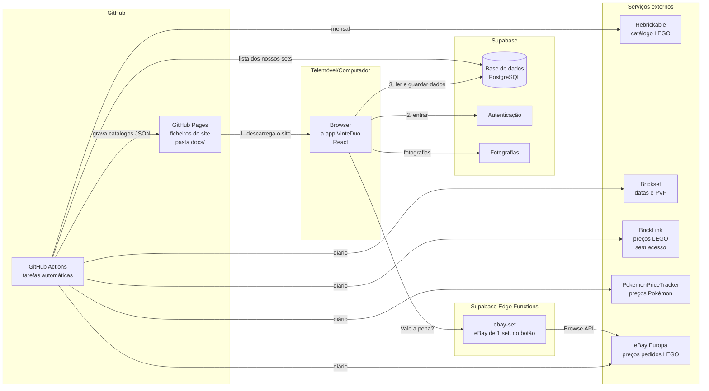
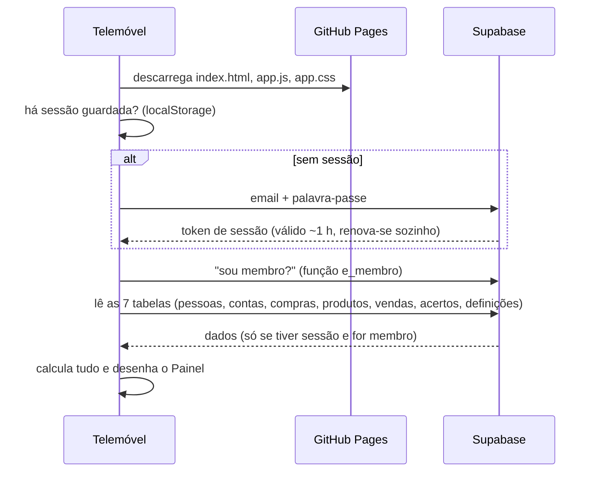
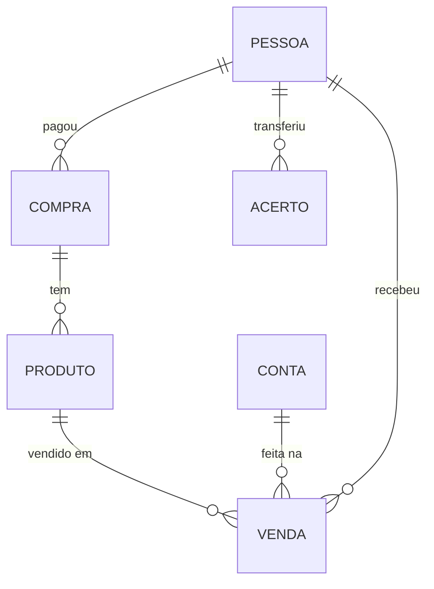
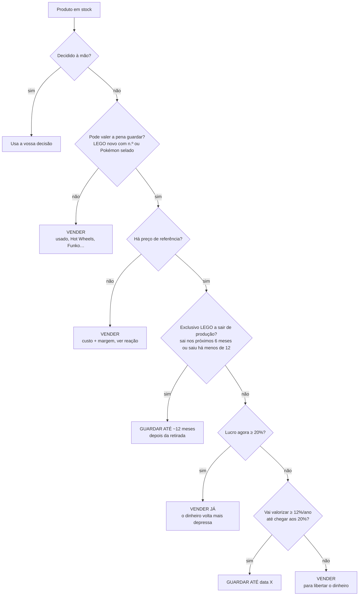

# VinteDuo

App web do Ricardo e da Cass para gerir a compra e venda de brinquedos (sobretudo LEGO e Pokémon) na Vinted. Funciona no telemóvel e no computador, os dados ficam sincronizados entre os dois, e pode ser instalada no ecrã inicial como se fosse uma app.

Além de registar compras e vendas, a VinteDuo trata o negócio **como um investimento**: mede quanto rende cada euro **e quanto tempo fica preso**, e sugere o que fazer com cada produto (vender já ou guardar até quando, e a que preço).

Este README explica **o que a app faz, como está construída e porquê**, para quem não é programador perceber as peças e como encaixam.

---

## Índice

1. [O que a app faz](#1-o-que-a-app-faz)
2. [A arquitetura numa imagem](#2-a-arquitetura-numa-imagem)
3. [Conceitos para perceber o código](#3-conceitos-para-perceber-o-código)
4. [Como os dados circulam](#4-como-os-dados-circulam)
5. [Modelo de dados](#5-modelo-de-dados)
6. [Regras do negócio e fórmulas](#6-regras-do-negócio-e-fórmulas)
7. [Investimento: análises, planos e tarefas](#7-investimento-análises-planos-e-tarefas)
8. [Dados externos (catálogo e mercado)](#8-dados-externos-catálogo-e-mercado)
9. [Segurança](#9-segurança)
10. [Mapa dos ficheiros](#10-mapa-dos-ficheiros)
11. [Como alterar a app](#11-como-alterar-a-app)
12. [Configuração inicial (feita uma vez)](#12-configuração-inicial-feita-uma-vez)
13. [Limitações conhecidas e próximos passos](#13-limitações-conhecidas-e-próximos-passos)

---

## 1. O que a app faz

| Ecrã | Para quê |
|---|---|
| **Painel** | Botões *Registar venda* e *Registar compra*, a lista **"O que fazer"**, as **promoções recebidas** de outra app (com quantos sets compensam) (anunciar, baixar preços, rever), os números do período, alertas de limites, acertos por fazer e vendas recentes. |
| **Produtos** | Stock e vendidos num só sítio. Filtros *Por anunciar / Anunciados / Vendidos* (podem combinar-se à vontade; ao abrir estão ligados Por anunciar e Anunciados). Produtos iguais aparecem agrupados num cartão (×N, custo médio); tocar abre o **detalhe do grupo** (`components/DetalheGrupo.tsx`): resumo (em stock, custo médio, vendidas, lucro), o anúncio/plano e uma **tabela com uma linha por unidade** de todos os produtos iguais (também as vendidas: compra, custo, estado, lucro); tocar numa linha abre esse produto. Não há expandir na lista. O **detalhe de um produto** usa a mesma tabela (`TabelaProdutos`), com esse produto destacado e os outros exemplares iguais (também vendidos), em vez da lista de campos e das vendas; o ciclo do set fica numa linha por cima. No detalhe de cada produto há um botão com o **ícone do lixo**, ao lado do ✏️, para apagar um produto inserido por engano (pede confirmação; não deixa apagar produtos com vendas; apaga também as fotografias). Cada produto mostra uma **bolinha tipo semáforo** e a próxima ação numa só linha (ver *Sinal dos produtos*). Por baixo do nome, só a categoria e o número do set (sem a palavra "Set"); a retirada do set fica no detalhe do produto. A pesquisa sugere produtos e categorias/subcategorias (ex.: *LEGO › Speed Champions*) enquanto se escreve; escolher uma categoria liga-a como filtro. |
| **Detalhe do produto** | Fotografias (com **Partilhar** e **Descarregar**, ver *Fotografias* abaixo), imagem oficial do set (com links para o site da LEGO, a Brickset e a **pesquisa do set na Vinted**) (ou do produto no TCGplayer, nos Pokémon), plano e preço sugerido, ciclo do set (lançamento, retirada real ou prevista e PVP, do Brickset), dados da compra, **Vendas** (deste produto e dos outros exemplares do mesmo set, com valor e lucro) e **Em stock** (outros exemplares do set por vender). Botões ✏️ (editar), 📷, *Anunciar/Retirar* e *Vendi*. |
| **Anunciar** | Escolhe a conta e o preço, e mostra o **título e a descrição prontos a copiar** para a Vinted e as **fotografias para partilhar** (ex.: diretamente para a app da Vinted) ou descarregar. |
| **Vendi** | Venda rápida: só preço e conta. |
| **Acertos** | Tipo Splitwise: quem deve quanto a quem, com as transferências mínimas. |
| **Contas** | As contas da Vinted com as barras dos limites (30 vendas / 2000 € por ano). Botão ✏️ para editar cada conta. |
| **Compras** | Lista das compras. É a única forma de entrar produtos novos. Tem o atalho **Vale a pena?**. |
| **Vale a pena?** | Antes de comprar. Um só ecrã (sem separadores), com uma linha no topo: **loja · procurar set · desconto**. Procurar filtra a lista da loja; um set que não esteja na lista mostra o detalhe dele: a app mostra por quanto se vende, em quantos dias, e **até que preço compensa comprar e quantas unidades** (bom / muito bom / oportunidade rara), a diversificar. Tem links para ver o set na Vinted e nos vendidos do eBay. Está na barra de baixo do telemóvel, no lugar onde estavam as Contas (que passaram para *Mais*). |
| **Análises** | Números do período (lucro, recebido, vendas, margem) com **▲▼ face ao período anterior** (períodos de 6 meses ou mais comparam-se com as mesmas datas do ano passado; os curtos com o período logo antes). **Destaques** (`lib/insights.ts`): melhor e pior tema por rentabilidade por ano (≥ 3 vendas), preço final vs. anunciado (mediana), dias anunciado até vender, stock com mais de 90 dias, vendas que ainda cabem este ano (e contas que no ritmo atual chegam ao limite), maior aposta em stock. **Rentabilidade vs. tempo por tema** (gráfico de pontos: ROI × dias até vender, tamanho = vendas); **investimento** (rentabilidade por ano, dinheiro parado, valor do stock); por categoria e conta; tabela por set; lotes de compra; idade do stock; tempo até vender. |
| **Definições** | Texto dos anúncios, regras das sugestões, pessoas, listas, exportação, dados de exemplo e histórico de alterações. |

---

## 2. A arquitetura numa imagem



Há **três peças principais**:

1. **O site (frontend)**: o código da app, em React. Está guardado no GitHub e publicado pelo **GitHub Pages**, que só serve ficheiros, sem programas a correr no servidor. Quando abres a app, o browser descarrega esses ficheiros e a app corre **inteiramente no teu telemóvel**. Todas as contas (lucro, acertos, sugestões) são feitas no próprio telemóvel.
2. **A base de dados (Supabase)**: um serviço na nuvem que guarda os dados partilhados entre os dois. Dá também as contas de utilizador (email e palavra-passe) e o espaço para as fotografias.
3. **Tarefas automáticas (GitHub Actions)**: pequenos programas que o GitHub corre sozinho, de tempos a tempos. Vão buscar dados de mercado a outros serviços e gravam-nos em ficheiros JSON junto ao site. A app lê esses ficheiros como qualquer outro.

**Porque é que é assim?** É simples, grátis e seguro:
- Não há servidor nosso para manter.
- O Supabase protege os dados com regras de acesso (ver [Segurança](#9-segurança)).
- As chaves dos serviços externos nunca chegam ao telemóvel, porque ficam no GitHub e só as tarefas automáticas as usam.

---

## 3. Conceitos para perceber o código

| Conceito | O que é | Onde aparece |
|---|---|---|
| **HTML / CSS / JavaScript** | A estrutura, o aspeto e o comportamento de uma página web. | `index.html`, `src/styles.css`, todo o `src/` |
| **TypeScript** | JavaScript com **tipos**: diz-se que forma tem cada dado (por exemplo, uma `Venda` tem `preco_venda: number`), e o compilador apanha erros antes de a app correr. | Ficheiros `.ts` e `.tsx` |
| **React** | Biblioteca para construir interfaces com **componentes**: funções que recebem dados e devolvem o que desenhar. Quando os dados mudam, o React volta a desenhar só o que mudou. | Todos os `.tsx` |
| **JSX** | A forma de escrever "HTML" dentro do JavaScript: `<Campo rotulo="Preço">…</Campo>`. | `.tsx` |
| **Props** | Os parâmetros de um componente. | `function Janela(props) {…}` |
| **Estado (`useState`)** | Dados que um componente guarda e que, quando mudam, fazem o ecrã atualizar. Por exemplo, o texto escrito num campo. | Formulários |
| **Hook** | Funções do React começadas por `use…`, que dão "poderes" a um componente: `useState` (estado), `useEffect` (fazer algo ao aparecer), `useMemo` (guardar um cálculo pesado). Também criámos hooks nossos: `useDados()`, `useRota()`, `useMercado()`. | Em todo o lado |
| **Contexto / Provider** | Uma forma de partilhar dados com todos os componentes sem os passar um a um. O `DadosProvider` guarda os dados e qualquer ecrã chama `useDados()`. | `src/state.tsx` |
| **Função pura** | Recebe dados e devolve um resultado, sem mexer em mais nada. É fácil de testar. Todos os cálculos são assim. | `src/lib/calc.ts`, `plano.ts`, `investimento.ts` |
| **JSON** | Formato de texto para dados: `{"nome": "Rivendell", "preco": 360}`. | Ficheiros de catálogo, campos `jsonb` |
| **API** | Uma "porta" de um serviço para outros programas pedirem dados por HTTP. | Supabase, Brickset, BrickLink… |
| **localStorage** | Uma pequena memória do browser, que fica só naquele dispositivo. | Sessão, modo demonstração, última conta usada |
| **PWA** | *Progressive Web App*: um site que se instala no ecrã inicial e abre em ecrã inteiro. Define-se no `manifest.webmanifest`. | `public/` |
| **Compilar (build)** | Transformar o TypeScript/JSX num só ficheiro JavaScript que o browser percebe. Quem o faz é o **esbuild**. | `scripts/build.mjs` → `docs/` |
| **Git / commit / push** | O Git guarda o histórico de todas as versões do código. *Commit* é uma versão gravada; *push* envia-a para o GitHub. | — |

---

## 4. Como os dados circulam

### Ao abrir a app



A app carrega **todos os dados de uma vez**. São poucos milhares de linhas, por isso é rápido, e as contas ficam instantâneas.

### Ao registar algo (por exemplo, "Vendi")

1. O formulário chama `guardar('vendas', [venda])`, de `src/state.tsx`.
2. `guardar` compara com o que existia e prepara uma entrada no **histórico**, só com os campos que mudaram.
3. Se for um produto a mudar de estado, regista sozinho o **período de anúncio**, em `lib/anuncios.ts`.
4. Envia para o Supabase com um *upsert*: cria a linha se não existir, ou atualiza-a se existir. Depois grava o histórico.
5. Atualiza logo a memória, para o ecrã mudar sem esperar.

### Sincronização entre os dois

Não há "tempo real". A app volta a carregar os dados **quando se regressa a ela** e **de minuto a minuto**. Há também o botão ↻ para atualizar à mão.

Para isto ser seguro com duas pessoas a usar a app ao mesmo tempo (`src/lib/sincronizar.ts`, revisão de nov/2026):

- **Definições sem perder alterações:** planos, tarefas adiadas, listas, vendas externas… são um bloco JSON cada. Antes de gravar, a app lê o valor atual no servidor e aplica só o que este telemóvel mudou (`fundir`, fusão a três: antes / depois / servidor). Assim, se o Ricardo muda um plano e a Cass adia uma tarefa no mesmo minuto, ficam as duas alterações.
- **Carregamentos atrasados:** um carregamento que esteve a decorrer enquanto se gravava é ignorado (trazia os dados de antes e a alteração parecia desaparecer durante um minuto). De dois carregamentos ao mesmo tempo, só conta o último.
- **Sem recalcular à toa:** o que não mudou continua a ser o mesmo objeto (`juntarDados`), por isso os cálculos pesados (`lib/memo.ts`) só se repetem quando há mudanças, e não a cada minuto.
- **Páginas estáveis:** o Supabase devolve no máximo 1000 linhas por pedido; a ordem leva sempre o `id` no fim, para nenhuma linha saltar ou repetir entre páginas (`listar`).
- **Histórico limitado:** o ecrã lê só as 300 alterações mais recentes, porque o histórico cresce sempre.

### Modo demonstração

Em vez do Supabase, os dados ficam no `localStorage` daquele browser. O resto da app não sabe a diferença, porque fala sempre com o mesmo "contrato" (`Store`, em `src/lib/store.ts`).

---

## 5. Modelo de dados



| Tabela | O que guarda | Campos principais |
|---|---|---|
| `pessoas` | Ricardo e Cass | `nome` |
| `contas` | Contas da Vinted e os seus limites | `nome`, `utilizador_vinted`, `titular_id` (quem recebe), `limite_vendas`, `limite_valor`, `periodo` |
| `compras` | Cada compra | `data`, quem pagou (`tipo_pagamento` + `pessoa_id`), `valor_artigos`, `portes`, `distribuicao` (os valores só servem para repartir ao registar; o total da compra é a soma dos produtos) |
| `produtos` | Cada produto (pode ter várias unidades) | `nome`, `set_numero`, `marca`, `tema`, `condicao`, `quantidade`, `preco_compra`, `custos_adicionais`, `estado`, `conta_id`, `preco_anuncio`, `fotos`, **`anuncios`** (períodos anunciado) |
| `vendas` | Cada venda | `produto_id`, `quantidade`, `data_venda`, `preco_venda`, `comissao`, `portes`, `conta_id`, `pessoa_id`, `estado`, `acertada` |
| `acertos` | Transferências já feitas entre as partes | `de`, `para`, `valor`, `data` |
| `definicoes` | Configurações (chave → JSON) | ver abaixo |
| `historico` | Todas as alterações (nunca se apaga) | `quando`, `utilizador`, `tabela`, `acao`, `antes`, `depois` |
| `membros` | Emails autorizados | `email` |

**Estados de um produto:** `por_anunciar` → `anunciado` → `vendido`. Também pode ficar `devolvido` ou `cancelado`. Anuncia-se uma unidade de cada vez: num produto com várias unidades, vender a anunciada põe as que sobram em `por_anunciar` (`estadoAposNovaVenda`), e só fica `vendido` quando não sobra nenhuma.
**Estados de uma venda:** `concluida`, `cancelada` ou `devolvida`. Não há estado intermédio: na Vinted um produto passa diretamente de anunciado a vendido, por isso uma venda nova fica logo `concluida`.

### O que está em `definicoes`

Para não ter de mudar a estrutura da base de dados a cada nova ideia, as configurações ficam todas nesta tabela, como pares **chave → valor JSON**:

| Chave | Conteúdo |
|---|---|
| `condicoes`, `temas`, `marcas`, `metodos_pagamento` | Listas de opções dos formulários |
| `nomes_mantidos` | Sets em que preferimos o nosso nome ao oficial |
| `vendas_externas` | Vendas feitas nas contas mas fora do negócio (contam só para os limites) |
| `vendas_fora_limites` | Vendas da app que a Vinted não conta (por exemplo, canceladas lá mas pagas por fora) |
| `modelo_anuncio` | Texto dos anúncios (título, descrição para novos e para usados, e `contas`: descrição própria de cada conta da Vinted) |
| `regras_plano` | Regras das sugestões vender/guardar |
| `planos` | Decisões manuais (vender / guardar até…) por set e condição |
| `tarefas_adiadas` | Tarefas escondidas até uma data |
| `pokemon_ids` | Associação manual de produtos Pokémon ao TCGplayer |
| `token_mercado` | Código que deixa a tarefa automática ler a lista dos nossos sets |
| `token_promocoes` | Código secreto para outra app enviar promoções (função `receber_promocao`) |
| `promocoes` | Promoções recebidas de outra app (as 50 mais recentes) |
| `promocoes_vistas` | Promoções dispensadas do Painel |
| `sets_avaliar` | Sets que acompanhávamos sem os ter (antigo botão *Acompanhar*, substituído pelo *Procurar no eBay*): a tarefa diária continua a ir buscar o eBay deles |
| `ebay_pesquisas` | Pesquisas do eBay por set: `{ data, mediana, anuncios, auto? }`, do botão *Procurar no eBay* ou da rotação automática do Continente (`auto: true`). No máximo uma por set a cada 7 dias. Escreve-se só pela função SQL `registar_pesquisa_ebay` |
| `token_rotacao_ebay` | Código que o pg_cron envia às funções `ebay-rotacao` e `wallapop-rotacao` |
| `wallapop_pesquisas` | Pesquisas da Wallapop por set em stock: `{ data, mediana, anuncios, hist: [[data, mediana, anuncios], …] }` (últimas 30). Escreve-se só pela função SQL `registar_pesquisa_wallapop` (rotação semanal) |

---

## 6. Regras do negócio e fórmulas

### Custos e lucro (`src/lib/calc.ts`)

```
custo unitário  = (preço de compra + custos adicionais) ÷ quantidade
líquido         = preço de venda − comissão − portes − outros custos
lucro da venda  = líquido − custo unitário × unidades vendidas
```

- Numa compra com vários produtos, o valor divide-se **em partes iguais** ou **pelo preço de cada um**. Os portes repartem-se em proporção ao preço, e os cêntimos que sobram vão para o último produto, para a soma bater certo (`distribuirCompra`).
- **O preço de cada produto é o que conta** (pedido do Ricardo, nov/2026). Depois de registada, o **total de uma compra é sempre a soma do custo dos seus produtos** (`totalCompra`): corrigir o preço de um produto atualiza a compra, o gasto, a caixa e o investimento recuperado. Ao editar uma compra, o formulário parte do preço atual de cada produto. Apagar o último produto de uma compra apaga também a compra.
- Só contam para o lucro as vendas **concluídas**.

### Acertos (`src/lib/acertos.ts`)

Funciona como o Splitwise. Quando uma venda fica **concluída**, quem recebeu o dinheiro:

1. **Devolve o custo** a quem pagou o produto: uma pessoa, a conta conjunta, ou as duas pessoas em partes iguais.
2. **Passa o lucro para a conta conjunta.**

Cada parte fica com um saldo, e as transferências já feitas abatem a esse saldo. No fim, a app **simplifica** as dívidas para o menor número de transferências. Vendas com `acertada = true` são de contas antigas já resolvidas e não entram.

### Limites das contas (`usoConta`)

A Vinted e as Finanças (diretiva **DAC7**) acompanham quem faz **30 vendas ou 2000 € por ano civil**. Para cada conta, a app soma:

- as vendas da app nessa conta, no ano;
- \+ as **vendas fora da app** (`vendas_externas`), como livros ou roupa vendidos na mesma conta;
- − as vendas que a Vinted não conta (`vendas_fora_limites`).

O aviso aparece aos 80%.

### Texto dos anúncios (`src/lib/anuncio.ts`)

É um modelo com marcadores, como `{marca} {numero} {nome}`, que são trocados pelos dados do produto. `{marca}` é a marca do produto ("Lego", "Pokémon"…), para um produto Pokémon não aparecer como Lego. Há um texto para produtos novos e outro para usados, editáveis em Definições. Cada conta da Vinted pode ter a sua descrição (pedido do Ricardo, para as contas não terem anúncios iguais); em branco usa a geral. A janela Anunciar mostra o texto da conta escolhida.

---

## 7. Investimento: análises, planos e tarefas

A ideia central: **um lucro de 20% em 1 mês vale muito mais do que 20% em 2 anos**, porque o dinheiro volta e pode ser reinvestido. Por isso a app mede sempre o **tempo**.

### Tempo anunciado (`src/lib/anuncios.ts`)

Sempre que um produto muda para *anunciado*, abre-se um período, e quando deixa de estar fecha-se, com o motivo (vendido ou retirado; vender a unidade anunciada de um produto com mais unidades conta como vendido, `fecharPeriodoVendido`). As mudanças de preço ficam registadas dentro do período. Tudo fica no campo `produtos.anuncios`. Assim, com o tempo, vai dar para saber quanto demora cada tipo de produto a vender **depois de anunciado** e se baixar o preço ajuda.

### Topo das Análises: Balanço e vendas por semana/mês

Pedido do Ricardo (nov/2026): perceber de relance quanto já se lucrou, quanto está parado e quanto se pode vir a ter. O cartão **Balanço** (`Balanco` em `pages/Analises.tsx`) é sempre **desde o início** (um balanço de um só período não faria sentido) e respeita os filtros de conta e pesquisa. São **4 cartões lado a lado** (2 × 2 no telemóvel) e, por baixo, a barra do investimento recuperado:

| Cartão | Fórmula | Exemplo (gastei 100 € em 2 produtos, vendi um por 90 €) |
|---|---|---|
| **Caixa** | recebido (líquido) − gasto | 90 − 100 = **−10 €** |
| **Lucro feito** | recebido − custo do que se vendeu | 90 − 50 = **+40 €** |
| **Em stock** | custo do que está em stock | **50 €** |
| **Se vender tudo** | lucro feito + lucro do stock ao preço de referência (`lucroPotencial`; sem preço conta pelo custo) | 40 + 40 = **+80 €** |
| **Investimento recuperado** (barra) | recebido ÷ gasto; verde = recebido, cinzento = por recuperar (ou azul = a mais, acima de 100%) | 90 ÷ 100 = **90%** |

O **gasto** é a soma do custo de todos os produtos (na data da compra a que pertencem, ou na sua data de compra se foram registados sem compra). Como tudo vem dos produtos, a caixa + o parado em stock dá sempre o lucro feito.

O período do topo começa em **Sempre** (as opções são Últimos 30 dias, Últimos 90 dias, Este ano, Sempre e Escolher datas; sem "Este mês" nem "Mês passado", a pedido do Ricardo) e aplica-se às vendas por semana/mês e ao resto do ecrã. A **pesquisa** é a mesma dos Produtos (`PesquisaProdutos`): ao escrever sugere categorias/subcategorias (ex.: "LEGO › Speed Champions") e produtos; escolher uma categoria liga-a como filtro (chip com ×) em todo o ecrã, incluindo o Balanço e a tabela por set (`correspondeFiltro` em `lib/calc.ts`, `lib/categorias.ts`). O texto compara sem maiúsculas nem acentos. As tabelas mais abaixo (lucro por categoria, por conta, subcategorias e tempo até vender) têm o **seu próprio período**, num seletor pequeno no canto de cada uma (por defeito Sempre); a conta e a pesquisa do topo aplicam-se a todas.

Logo a seguir, **Vendas por semana** ou **por mês**: o eixo do tempo segue o período do topo. Com **Sempre** (ou datas com mais de um ano) as barras são **meses** (`porMes`, do 1.º mês com dados até hoje, meses vazios incluídos); nos outros períodos são **semanas** de segunda a domingo (`porSemana`, da semana do início do período à do fim, semanas vazias incluídas). Em cada barra, uma barra com o **recebido** e, por baixo noutra cor, a parte que é **lucro**; ao lado, uma barra **vermelha** com os **gastos** em compras dessa semana. Tocar numa barra mostra o n.º de vendas, o recebido, o lucro e os gastos (`estatisticas` → `porSemana`/`porMes`, `BarrasSemanas`).

### Análises de investimento (`src/lib/investimento.ts`)

```
rentabilidade por ano = lucro ÷ (custo × dias com o dinheiro preso ÷ 365)
dinheiro parado       = custo do stock, e há quantos dias está parado (média pesada pelo custo)
valor estimado        = unidades em stock × preço de mercado (BrickLink, eBay/Wallapop com desconto, TCGplayer ou a nossa venda média)
```

Conta **o que já foi vendido**, que dá a rentabilidade real, **e o que está em stock**, que dá o dinheiro parado e o valor estimado.

### Planos e tarefas (`src/lib/plano.ts`)

Para cada produto em stock, a app decide um **plano**:



- **Preço de referência**, por esta ordem: as nossas vendas do mesmo produto nos últimos 2 anos (as do último ano pesam mais) → BrickLink → **mercado: eBay e Wallapop** (eBay: mediana dos anúncios de novos na Europa, com o **desconto real medido nas nossas vendas**, ver abaixo; Wallapop: mediana dos anúncios de novos em PT/ES × a percentagem a que vendemos, ver *Wallapop*; com os dois, a média pesada pelo n.º de anúncios de cada um, no máximo 20) → TCGplayer (Pokémon) → PVP da Brickset: com 20% de desconto se ainda estiver à venda na LEGO, ou, se já foi retirado, o PVP valorizado desde a retirada com as mesmas taxas das regras (no máximo o dobro do PVP).
- **Subida da retirada ("pop"), só nos exclusivos LEGO:** um set **vendido só pela LEGO** (Brickset: "LEGO exclusive") perto da retirada (sai nos próximos 6 meses ou saiu há menos de 12, pela data real do Brickset) guarda-se até ~12 meses depois da retirada, mesmo que já dê lucro. Os sets vendidos nas lojas normais **não** se guardam por esta regra: vendem-se quando o lucro compensa. O plano mostra uma estimativa do valor nessa data, só como informação. Os 2 números de meses editam-se em Definições. Sets especiais que não são exclusivos (ex.: minifigura muito procurada) decidem-se à mão.
  - **Porquê (out/2026):** analisaram-se 10 sets no BrickEconomy, comparando com o **PVP europeu** (o BrickEconomy usa o mercado dos EUA e o preço de lá, mais baixo). Os sets das lojas quase não subiram depois da retirada, mesmo os grandes: Lamborghini Countach 0%, Triwizard −10%, Dobby e Batmobile +15–25% e depois parados, Disney Duos +25%. Na Vinted recebe-se ~0,85 do valor do BrickEconomy (variando entre 0,6 e 1,3). Nos exclusivos LEGO não há promoções nas lojas a encher o mercado, e a subida demora 12–18 meses a construir-se. Nessa altura passaram de 18 para 4 os produtos guardados (828 € → 443 €).
- **Valorização esperada** (taxas fixas iguais para todos os sets, editáveis em Definições; não é uma previsão por set):
  - **LEGO:** ~0% enquanto a LEGO ainda o vende; ~5%/ano nos 2 anos depois de ser retirado; ~3%/ano depois disso (medido em out/2026; antes eram 20% e 7%, otimistas demais).
  - **Pokémon selado:** ~15%/ano.
  - A data de retirada vem da Brickset (real, ou prevista para os sets ainda à venda). Sem ela, estima-se como ano de lançamento + 2,5 anos.
- **Desconto real sobre o eBay** (`calibrarEbay` em `src/lib/investimento.ts`): os preços do eBay são pedidos, e nós vendemos na Vinted. Para cada set que já vendemos, calcula-se *preço a que vendemos ÷ preço pedido no eBay* **na mesma altura**; a mediana desses rácios (por set) dá a percentagem que costumamos conseguir, e o desconto é o resto. Comparar uma venda antiga com o eBay de hoje enganava: se o set foi retirado entretanto, o eBay subiu e parecia que vendemos barato (out/2026: 0,57 nesses sets contra 0,67 nos que não mudaram de fase). Por isso cada venda compara-se com:
  1. o **histórico do eBay** (`ebay_hist` em `mercado-sets.json`) mais próximo da data da venda, até 30 dias de diferença;
  2. se ainda não há histórico dessa altura (começou a 28/10/2026), o eBay de hoje, **só se o set ainda está à venda na LEGO** (não mudou de fase desde a venda);
  3. senão, a venda não entra.

  Usam-se as vendas de sets novos do último ano (ou dos últimos 2 anos, se houver poucas) e é preciso pelo menos 10 sets; com menos, usa-se a regra de reserva "Desconto sobre o eBay" (37%). **Ajusta-se sozinho a cada venda**: cada venda nova entra logo, comparada com o eBay do dia em que foi feita. As Definições mostram quantos sets vieram do histórico e quantos do eBay de hoje. Em out/2026: vendemos a ~63% do eBay (22 sets comparáveis) → desconto de 37%. O mesmo desconto entra no valor estimado do stock e no **Vale a pena?**.
- **Preço sugerido** = referência + 8% (margem para negociar), nunca abaixo de custo + 5%.
- **Baixar o preço:** ao fim de **60 dias** anunciado sem mudar de preço, sugere baixar 7%.

Todos estes números estão em **Definições → Regras das sugestões** e podem ser mudados.

A lista **"O que fazer"** no Painel junta as tarefas: *Anunciar X a Y €*, *Baixar X para Y €* e *Rever X* (quando acaba um prazo de guardar escolhido por vocês). Cada tarefa pode ser **adiada** 14 dias. Tocar no título "O que fazer" minimiza ou maximiza a lista (fica lembrado em cada dispositivo).

**Fotos no detalhe do grupo** (pedido do Ricardo): o detalhe de um grupo de produtos iguais tem as fotos e os mesmos três ícones do detalhe do produto (adicionar, descarregar, partilhar). As fotos são as do primeiro produto igual que já tem fotos (senão o mais antigo), e as novas juntam-se a esse. O envio é o mesmo nos dois sítios (`useEnviarFotos` em `components/fotos.tsx`).

**PVP na caixa do plano** (pedido do Ricardo): debaixo do plano (ou do anúncio) aparece o preço normal do produto. Para LEGO vem da Brickset; nos produtos sem PVP conhecido (ex.: Pokémon) há um link *indicar* para o escrever à mão, que fica guardado em `definicoes.pvps` (chave → €, pela chave de comparação, por isso vale para todos os produtos iguais) e pode ser alterado depois (`pvpDoProduto`, `LinhaPvp`). É só informativo, não entra nos cálculos.

**Aviso na janela Anunciar** (`vezesNaConta`): se a conta escolhida já tem 2 ou mais unidades do mesmo produto (vendidas nessa conta ou lá anunciadas agora), aparece um aviso para considerar outra conta, porque a Vinted reclama de muitos artigos iguais na mesma conta. Os anúncios retirados sem venda não contam. É só um aviso.

**Caixa do produto** (`LinhaPlano`): curta, sem textos a explicar. Anunciado → *Anunciado a X € na conta · há N dias* e *Lucro +Y € (Z%)*. Por anunciar → *Plano: vender · anunciar a X €* (o porquê, ou seja como foi calculado o plano e o preço, aparece ao tocar no "?" do canto superior direito). O "aceitar ofertas até" foi retirado (as ofertas decidem-se pela experiência).

**Sinal dos produtos** (`sinais()` em `src/lib/plano.ts`, desenhado por `SinalProduto` em `planos.tsx`): em vez de várias etiquetas, cada cartão tem uma bolinha de cor e uma linha com a próxima ação. A cor responde a "tenho de fazer alguma coisa?" e usa as mesmas tarefas do "O que fazer":

| Cor | Quando | Texto |
|---|---|---|
| 🟢 Verde | Anunciado há até 60 dias, ou outra unidade igual já está anunciada | *Anunciado há 12 dias* / *Outro igual já anunciado* |
| 🟡 Amarelo | Há uma ação: anunciar (plano vender) ou baixar o preço | *Anunciar a 89 €* / *Baixar para 38 €* |
| 🔵 Azul | Guardado de propósito, ou a tarefa de anunciar foi adiada | *Guardar até jul/27* / *Anunciar adiado* |
| 🔴 Vermelho | Anunciado há mais de 60 dias (`DIAS_PARADO`), ou acabou o prazo de guardar escolhido por vocês | *74 dias · baixar para 39 €* / *Prazo de guardar acabou* |
| ⚪ Cinzento | Já não está em stock | *Vendido* / *Cancelado* / *Devolvido* |

Um grupo de produtos iguais mostra o sinal da unidade mais urgente. Ao passar o rato aparece o porquê (o motivo do plano ou da tarefa). Na importação do Excel os anunciados ficaram todos com data de anúncio 27/10/2026, por isso os vermelhos só começam a aparecer com o tempo.

**Anuncia-se uma unidade de cada vez.** Se já há um produto igual anunciado (mesmo n.º de set ou nome), as outras unidades não aparecem como "Anunciar" até essa ser vendida.

### Vale a pena? Até que preço comprar, e quantas unidades (`src/lib/avaliar.ts`, ecrã `pages/Avaliar.tsx`)

Escreve-se só o n.º do set. A app calcula (`precosCompra`):

```
preço de venda esperado = a primeira que existir de:
    1. as nossas vendas deste set (as mesmas dos planos)
    2. eBay: mediana pedida (botão Procurar no eBay, ou a da tarefa diária se for mais recente) × a % a que costumamos vender (calibrarEbay)
       + Wallapop: mediana pedida (rotação semanal) × a % a que costumamos vender (calibrarWallapop, reserva 85%)
       → com os dois, uma linha "Mercado" com a média pesada pelo n.º de anúncios
    3. PVP × a % do PVP a que costumamos vender (calibrarPvp), à parte para sets à venda e retirados
dias até vender        = mediana (compra → venda) das nossas vendas deste set; senão do tema (≥ 5 vendas); senão de todas
preço máximo (escalão) = venda esperada ÷ (1 + margem do escalão), e nunca mais do que venda − 5 €
```

| Escalão | Lucro mínimo (regra) | Unidades a ter (contando o stock) |
|---|---|---|
| 🟡 Bom | 20% (`margemVender`) | 1 |
| 🟢 Muito bom | 40% (`margemCompraOtima`) | até 2 |
| 🟢 Oportunidade rara | 75% (`margemCompraRara`) | até 3 |

Acima do preço do escalão **Bom** não compensa comprar.

**Diversificar (decisão do Ricardo):** acumular muitas unidades do mesmo set só compensa numa oportunidade de outro mundo. Anuncia-se uma unidade de cada vez, por isso cada unidade a mais demora mais a vender e prende dinheiro. Além das unidades por escalão, **nunca se fica com mais de 10% do dinheiro em stock num só set** (`maxCapitalPorSet`); se ainda não há nenhuma unidade, deixa-se sempre comprar 1. As três regras editam-se em Definições. Cada linha mostra também o lucro e quanto rende por ano a esse preço (com várias unidades, o dinheiro fica preso em média (n + 1) ÷ 2 vezes o tempo de uma venda).

Mostra ainda, de forma simples, de onde vem o preço de venda: uma linha por fonte, com ✓ na que conta (as nossas vendas; o eBay com o preço típico e o n.º aproximado de anúncios; ou o PVP × o rácio a que vendemos). Sem notas técnicas sobre o eBay, o tempo até vender ou as vendas que restam nas contas (pedido do Ricardo, nov/2026); o erro típico continua a contar no cálculo das promoções.

**Limitação:** os dias até vender vêm das datas de compra, que na importação da folha ficaram no dia 1 do mês, e incluem sets guardados de propósito. Servem só como ordem de grandeza. Quando houver dados suficientes do tempo **anunciado** (desde 27/10/2026), passa a usar-se esse.

(`avaliarCompra` continua disponível para avaliar um preço concreto: lucro, margem, rentabilidade e veredicto.)

Desde nov/2026 (pedido do Ricardo) não há separadores "Um set" / "Promoção da loja": é tudo o mesmo ecrã. No topo, numa só linha: o seletor da loja (as lojas que enviaram listas + *Outra lista*), a caixa para procurar um set (n.º, "começa por", ou parte do nome) e o desconto (%). Se o set procurado não está na lista da loja, ou não há lista, aparece o detalhe dele (o que antes era "Um set").

Em cada escalão, à frente de "até X €", aparece o **desconto sobre o PVP** necessário para lá chegar (`descontoPara`: 1 − X ÷ PVP, arredondado ao 1% acima), ou "(PVP)" se o próprio PVP já serve.

Se já temos o set, o detalhe mostra o cartão **Em stock** (`NossoStock`): uma linha por unidade, com a data de compra, a condição, os dias em stock, o estado (anunciado a quanto e em que conta, ou por anunciar) e o custo; tocar abre o produto. Por baixo, as nossas vendas desse set.

#### Promoção da loja (modo do mesmo ecrã, `components/AvaliarPromocao.tsx`, `avaliarPromocao`)

Tocar num set da lista abre o mesmo detalhe do modo "Um set" (`components/DetalheSet.tsx`, `JanelaSet`), com o preço da promoção no topo e as nossas vendas desse set. É calculado na hora com o que a app já tem carregado (vendas, `mercado-sets.json`, catálogo, pesquisas do eBay guardadas). Só o botão *Procurar no eBay* guarda alguma coisa (ver abaixo).

- **Escolhe-se a loja** (seletor com as lojas que já enviaram listas, ex.: *Continente*) e a app mostra a **lista mais recente dessa loja** (`lojasRecebidas`). *Outra lista* deixa colar uma lista à mão: os números, ou o texto copiado da página da loja; `extrairItens` encontra os sets, os preços e as percentagens (ignora códigos de barras e números que não são sets).
- **Desconto extra** (pedido do Ricardo): promoções que a lista não mostra e valem para tudo, ex.: **10% em cartão no Continente**. Aplica-se sobre o preço de cada set: 100 € a −30% = 70 €, e com os 10% do cartão fica **63 €**. Vem preenchido com o valor da loja (`EXTRA_POR_LOJA` em `lib/promocoes.ts`: Continente 10%) e pode mudar-se quando houver uma promoção melhor. Numa lista colada sem preços, é o desconto da loja sobre o PVP.

```
PVP              = o da loja (se vier na lista), senão o da Brickset (LEGO Alemanha)
preço na loja    = preço final da lista → senão PVP × (1 − desconto do set) → senão o PVP
preço final      = preço na loja × (1 − desconto extra)
escalão / unidades = os mesmos do modo "Um set" (bom / muito bom / oportunidade rara, a diversificar)
compensa a partir de = desconto da loja sobre o PVP que, já com o extra, chega ao preço máximo "bom"
```

**Cada linha** (pedido do Ricardo, nov/2026, pensado para o telemóvel): por cima o set e "Comprar N" ou "Não comprar"; por baixo, em destaque e lado a lado, **PVP · Preço (desconto) · Vende por (desconto necessário)**. O preço e o desconto são os **da loja** (os do folheto), a mesma base do desconto necessário, para se poderem comparar; o preço já com o extra do cartão aparece na linha pequena; o desconto necessário é o "compensa a partir de" (comprar 1, escalão bom), ou "PVP" se compensa sem desconto. No telemóvel, os descontos passam para baixo dos valores. Numa linha pequena, o lucro. O escalão vê-se só pela cor da bolinha.

**Ordem** (pedido do Ricardo, nov/2026): por defeito, *Menos desconto necessário*: cada set mostra "precisa de ≥X%" (o "compensa a partir de") e a lista vai do que precisa de menos desconto para o que precisa de mais (`ordenarPorDesconto`). *Recomendação* volta à ordem antiga, abaixo.

A *Simular promoção anunciada* foi retirada (pedido do Ricardo, nov/2026): o "precisa de ≥X%" de cada set já diz com que desconto passa a compensar.

**⚡ Pode esgotar** (`sinaisEsgotar`, para comprar logo): sai de produção nos próximos 6 meses ou já saiu (Brickset), no eBay pedem pelo menos o PVP (novo), ou nós vendemos esse set em ~30 dias ou menos (mediana). Não sabemos o stock da loja, por isso é uma estimativa. O botão *⚡ Só os que podem esgotar* filtra a lista. O botão *Retirado há +6 meses* mostra só os sets que saíram de produção há pelo menos 6 meses (data de retirada da Brickset; sets sem data não entram, `retiradoHaMeses`); os dois filtros podem usar-se juntos.

Na ordem *Recomendação*, os que compensam aparecem primeiro, pelo **lucro seguro** (o lucro mesmo que a venda fique abaixo do esperado pelo erro típico da fonte). Numa lista recebida mostram-se só os que compensam e os que têm desconto; os outros ficam em *Mostrar os outros N*. **Diversificar por tema:** no máximo 2 compras do mesmo tema por promoção. Mostra o total a gastar, descarrega para Excel (CSV) A lista não pede o eBay ao abrir: usa as pesquisas guardadas (os sets do Continente vão sendo procurados sozinhos, ver *Rotação do Continente*) e o eBay da tarefa diária. Para pesquisar já um set, toca-se nele e carrega-se em *Procurar no eBay*.

A app **não abre o link da loja**: o browser não deixa uma página ler outros sites, e fazê-lo num servidor seria recolha automática (termos de uso).

Com os dados de out/2026: nos 124 sets que já tivemos, compensa comprar a partir de **~44% de desconto** (mediana). Na primeira lista do Continente (70 sets, 30/10), com os 10% do cartão, compensava 1 (72044 Mario Kart Piranha Plant, −30% → 31,49 €).

---

## 8. Dados externos (catálogo e mercado)

Estes dados são preparados por **GitHub Actions** (pasta `.github/workflows/`). A app só lê os ficheiros JSON que elas geram.

| Ficheiro | Gerado por | Quando | Conteúdo |
|---|---|---|---|
| `public/catalogo-sets.json` | `scripts/catalogo.py` | Mensal | ~26 mil sets LEGO (Rebrickable): nome, ano, tema. Preenche o formulário ao escrever o n.º do set. |
| `public/mercado-sets.json` | `scripts/mercado.py` | Diário (5h43 UTC) | **eBay**: mediana dos preços pedidos por cada set nosso, novo, nas lojas eBay da Alemanha, França, Espanha e Itália. Guarda também o **histórico do eBay** (`ebay_hist`: uma linha por set quando o preço muda, ou pelo menos uma por semana). **PokemonPriceTracker**: preço dos produtos Pokémon selados (TCGplayer, EUA). **Brickset**: lançamento, retirada (real ou prevista), PVP. **BrickLink**: preparado, sem acesso. |

### Procurar no eBay (botão, função `ebay-set` no Supabase)

O ecrã **Vale a pena?** precisa do eBay de sets que talvez nunca tivemos, e a tarefa diária só vai buscar os nossos. Por isso há uma **Edge Function** no Supabase (`supabase/functions/ebay-set/index.ts`), um pequeno programa que corre na nuvem do Supabase quando é chamado:

1. A app chama-a com o token da sessão; a função confirma com `e_membro` que quem pede é membro (senão recusa).
2. Usa as chaves do eBay **guardadas nos segredos do Supabase** (não no código nem no telemóvel) e faz a mesma pesquisa da tarefa diária (novos, preço fixo, eBay DE/FR/ES/IT, n.º do set no título, sem partes).
3. Devolve a mediana do preço pedido e o n.º de anúncios. A app aplica o mesmo desconto real (`calibrarEbay`).

**Corre quando se carrega no botão** *Procurar no eBay* do detalhe do set (pedido do Ricardo, nov/2026); abrir o detalhe ou uma promoção não pesquisa nada. A própria função guarda o resultado em `definicoes.ebay_pesquisas` (função SQL `registar_pesquisa_ebay`, partilhado pelos dois) e conta logo nas avaliações, aqui e nas promoções. **O mesmo set só se volta a procurar passados 7 dias**: até lá o botão mostra a data da pesquisa e a partir de quando se pode repetir. Se a tarefa diária tiver um eBay mais recente desse set, usa-se o dela.

Se as chaves ainda não estiverem no Supabase, a função responde `sem_chaves` e o botão avisa que faltam; nada fica guardado.

### Wallapop (função `wallapop-rotacao`)

O "preço da concorrência" (pedido do Ricardo, nov/2026). A Wallapop não tem API pública: usa-se a mesma pesquisa que o site pt.wallapop.com faz, sem login e com muito pouco volume.

- O **pg_cron** chama a função `wallapop-rotacao` **a cada 10 minutos** (com o `token_rotacao_ebay`). Cada chamada faz **1 pesquisa** ("lego <set>") de 1 set: os LEGO **em stock** (por anunciar ou anunciados) não procurados há menos de 7 dias (`sets_rotacao_wallapop`, máx. 100 por dia). Com ~75 sets, são ~11 pesquisas por dia.
- **Filtros** (`supabase/functions/_shared/wallapop.ts`, testados em `tests/wallapop.test.ts`): só anúncios com o n.º do set no título; fora caixas vazias, suportes/molduras expositoras, instruções, luzes, peças/mods, minifiguras, lotes e títulos com outro n.º de set; fora os que dizem usado/montado/sem caixa/incompleto; fora preços abaixo de 40% ou acima de 250% da mediana. Com menos de 3 anúncios válidos não há mediana. No teste de nov/2026 (8 sets) o ruído ia de 0% a 70% dos anúncios; quase todos são de Espanha.
- Guarda em `definicoes.wallapop_pesquisas` (`registar_pesquisa_wallapop`), com o histórico das últimas 30 pesquisas de cada set.
- **Na app** (`src/lib/wallapop.ts`): conta a última pesquisa com mediana e até 30 dias. É preço **pedido**, por isso × a percentagem a que vendemos: medida nas nossas vendas face à Wallapop da mesma altura (±30 dias, `calibrarWallapop`, a partir de 10 sets) ou, até lá, **85%** (`RACIO_WALLAPOP`: em nov/2026 os nossos anúncios estavam ao nível da mediana da Wallapop e vendemos a ~83% do último preço anunciado). Junta-se ao eBay (`juntarMercado`): média pesada pelos anúncios (máx. 20 cada).
- Não há vendidos: os anúncios vendidos desaparecem da pesquisa.
- Para parar: `select cron.unschedule('wallapop-rotacao');` no SQL Editor do Supabase.

### Rotação do Continente (função `ebay-rotacao`)

Para o eBay já estar lá quando chega uma promoção, os sets do **Continente** vão sendo procurados sozinhos (pedido do Ricardo, nov/2026):

- O **pg_cron** do Supabase chama a função `ebay-rotacao` **a cada 7 minutos**, com o código `definicoes.token_rotacao_ebay`. Cada chamada procura **1 set**, nas 4 lojas do eBay uma de cada vez, com 2 s entre pedidos. Assim as chamadas ficam espalhadas pelo dia.
- Qual set: a função SQL `sets_rotacao_ebay` escolhe da **última lista do Continente** os que não temos em stock (esses já vêm na tarefa diária) e não foram procurados há menos de 7 dias: primeiro os nunca procurados com desconto, depois os outros, depois os mais antigos.
- **No máximo 200 sets por dia** (hora de Lisboa), ~800 das 5000 chamadas diárias da Browse API. Em nov/2026 a lista tinha 647 sets (603 sem os nossos): a primeira volta demora ~3 dias; depois, com a regra dos 7 dias, são ~90 por dia.
- Para parar: `select cron.unschedule('ebay-rotacao');` no SQL Editor do Supabase.

### Promoções enviadas por outra app (função `receber_promocao`)

Uma app externa (ex.: a do Ricardo que tira a lista de LEGO em promoção no Continente) pode enviar a lista sozinha. A VinteDuo mostra-a no Painel com quantos sets compensam; tocar abre o **Vale a pena? → Promoção da loja** já preenchido (`#/avaliar/promo/<id>`).

- **Como enviar:** `POST https://hunuxphczekrxilfmthb.supabase.co/rest/v1/rpc/receber_promocao`, com os cabeçalhos `apikey: <chave publishable>` e `Content-Type: application/json`, e o corpo:

  ```json
  {
    "token": "<código secreto>",
    "loja": "Continente",
    "valida_ate": "2026-11-10",
    "itens": [
      { "set": "75375", "pvp": 84.99, "preco": 63.74, "desconto": 25 },
      { "set": "42151", "pvp": 49.99, "desconto": 30 },
      { "set": "10280", "preco": 35.99 },
      { "set": "76303", "desconto": 20 }
    ]
  }
  ```

  | Campo do item | O que é | Obrigatório |
  |---|---|---|
  | `set` | n.º do set (`"75375"` ou `"75375-1"`) | sim |
  | `pvp` | preço original na loja, em € | não (senão usa-se o PVP da Brickset) |
  | `preco` | preço final, já com desconto, em € | um destes dois |
  | `desconto` | desconto em %, ex.: `30` | um destes dois |

  Preço usado: `preco`; senão `pvp` × (1 − `desconto` ÷ 100). São obrigatórios `token`, `loja` e `itens` (ou, em alternativa, `texto`: a lista como se cola na app, onde cada set pode ter o preço `63,74 €` ou o desconto `-30%` na linha ou por baixo). `valida_ate` é opcional. Para compatibilidade, aceita-se ainda `desconto` no topo, aplicado aos itens sem preço nem desconto. Resposta: `{"ok": true, "id": "…"}`.
- **O código secreto** está em `definicoes.token_promocoes`, e vê-se e copia-se em **Definições → Receber promoções de outra app**, onde também estão estas instruções. Só deixa entregar promoções: não dá acesso a mais nada. Nunca vai para o código nem para o chat.
- **Onde ficam:** em `definicoes.promocoes`, as 50 mais recentes, e cada receção fica no histórico. O Painel mostra as dos últimos 7 dias, ou as que ainda estão dentro de `valida_ate`, até serem dispensadas.
- **Preço de cada set**, por esta ordem: (1) o preço final (`preco`, ou no texto o mais baixo da linha do set e das seguintes sem outro set; um preço absurdo face ao PVP, < 20% ou > 105%, é ignorado); (2) PVP × (1 − **desconto do set**: `desconto`, ou no texto a maior percentagem, ex.: `-30%`); (3) PVP × (1 − desconto geral). O PVP é o da loja (`pvp`) se vier, senão o da Brickset. Atenção: uma percentagem que não seja desconto (ex.: "IVA 23%") junto ao set seria lida como desconto. Código: `extrairItens` (`lib/avaliar.ts`), `lib/promocoes.ts`, `components/CartaoPromocoes.tsx`.

### As chaves (segredos)

Ficam em **GitHub → Settings → Secrets and variables → Actions**. Se uma faltar, essa fonte é ignorada e os dados anteriores mantêm-se.

| Segredo | Para quê |
|---|---|
| `VINTEDUO_TOKEN` | Deixa a tarefa pedir ao Supabase **só** a lista dos nossos n.º de set e nomes Pokémon, através das funções `sets_mercado` e `pokemon_mercado`. Não dá acesso a mais nada. |
| `BRICKSET_API_KEY` | Brickset (grátis, pedida em brickset.com). |
| `BRICKLINK_CONSUMER_KEY`, `BRICKLINK_CONSUMER_SECRET`, `BRICKLINK_TOKEN`, `BRICKLINK_TOKEN_SECRET` | BrickLink. **Sem acesso:** a API só está disponível para vendedores com loja na BrickLink. |
| `POKEMONPRICETRACKER_API_KEY` | PokemonPriceTracker (plano grátis: 100 pedidos por dia). |
| `EBAY_CLIENT_ID`, `EBAY_CLIENT_SECRET` | eBay Browse API: o *App ID* e o *Cert ID* do "Production keyset" de uma conta grátis em developer.ebay.com. |

**Segredos do Supabase** (*Edge Functions → Secrets*): `EBAY_CLIENT_ID` e `EBAY_CLIENT_SECRET`, os mesmos valores do GitHub, para a função `ebay-set`. Os segredos do GitHub não se conseguem ler de volta, por isso copiam-se de novo a partir de developer.ebay.com.

Para correr a tarefa à mão: **Actions → "Atualizar dados de mercado" → Run workflow**.

Se o eBay recusar as chaves, a tarefa não falha: grava o motivo em `ebay_erro` dentro de `mercado-sets.json` (a resposta do eBay, que nunca inclui as chaves) e as outras fontes atualizam-se na mesma. As chaves são lidas sem espaços à volta.

**Pokémon:** os nossos nomes são curtos ("ETB"), por isso a pesquisa por nome pode encontrar o produto errado. Para evitar isso:

- O resultado só é aceite automaticamente se for **inequívoco**: todas as palavras que identificam o nosso produto aparecem no nome encontrado (palavras genéricas como "box" ou "elite" não contam) e nenhum outro resultado empata.
- Se houver dúvida, a tarefa guarda até 3 **candidatos**, e no detalhe do produto aparece **"Qual destes é?"**. A escolha fica em `pokemon_ids` e o preço passa a contar logo.
- **O banner de associação só aparece até a associação estar confirmada** (pedido do Ricardo): com o que a pesquisa encontrou e o botão **Está certo**, os candidatos, ou "Não é este produto?". Depois de confirmada, desaparece do detalhe e muda-se no **Editar** do produto (campo *Produto no TCGplayer*: ver, mudar pelo n.º ou endereço, ou remover). Código: `LinhaPokemon` e `AssociacaoTcg` em `components/planos.tsx`.
- Se não for nenhum, em *"Não é nenhum destes"* cola-se o endereço da página do produto no TCGplayer.
- Um preço automático absurdo face ao custo (mais de 4× ou menos de ¼) é ignorado.
- Produtos em espanhol ou português não existem no TCGplayer, que é só inglês. Associar à versão inglesa dá uma referência aproximada.

**Imagens Pokémon:** um produto Pokémon sem fotografia nossa mostra a imagem do produto no TCGplayer (`tcgplayer-cdn.tcgplayer.com/product/<id>_200w.jpg`, ou `_in_1000x1000.jpg` no detalhe), tal como os LEGO mostram a do Brickset. A imagem não é guardada, é o browser que a vai buscar. Só aparece quando já se sabe qual é o produto: associação automática inequívoca (e com preço não absurdo) ou escolhida em "Qual destes é?", onde os candidatos também mostram a miniatura. Se a imagem não carregar, fica o ícone ⚡. Código: `idTcgPokemon` e `urlImagemTcg` em `src/lib/investimento.ts`, `useImagemReferencia` em `src/components/ui.tsx`.

---

## 9. Segurança

- **Só os membros veem os dados.** Todas as tabelas têm **RLS** (*Row Level Security*): regras na própria base de dados que só deixam ler e escrever a quem tem **sessão iniciada** e cujo email está na tabela **`membros`**. Estão definidas em `supabase/schema.sql`.
- **A chave do Supabase no código é pública por natureza** (*publishable*). Sozinha não dá acesso a nada, por causa das regras acima. A chave secreta (`service_role`) e a palavra-passe da base de dados **nunca** entram no código.
- **O repositório é público**, por isso as chaves dos serviços externos ficam só nos segredos do GitHub e do Supabase (Edge Functions), nunca no código.
- **A função `receber_promocao`** só aceita pedidos com o código `token_promocoes`, e só escreve na lista de promoções.
- **A função `ebay-set`** só responde a quem tem sessão e é membro (confirma com `e_membro`, usando o token de quem pede).
- **Histórico imutável:** a tabela `historico` só aceita linhas novas. Nem a app consegue alterar ou apagar o histórico.
- **Fotografias privadas:** o bucket `fotos` só é acessível com sessão.

### Fotografias (`src/lib/fotos.ts`, `src/components/fotos.tsx`)

- **Duas versões de cada fotografia** no Storage do Supabase (bucket `fotos`): a **original** com boa qualidade (até 2048 px, JPEG 90%, ~0,5–1 MB), para partilhar ou descarregar, e a **miniatura** (400 px, ~30 KB, mesmo caminho com `.min.jpg`), que é a que a app mostra. No produto (`produtos.fotos`) fica só o caminho da original.
- **Porquê:** o plano grátis do Supabase tem 1 GB de espaço e **5 GB de tráfego por mês**. As miniaturas poupam o tráfego; as originais só se descarregam ao partilhar. Em out/2026 havia 20 fotografias (5,6 MB). Fotografias antigas, sem miniatura, ganham-na sozinhas da primeira vez que são vistas.
- **Mesmo tamanho para todas** no detalhe do produto: um quadrado com 3/4 da largura do ecrã, cortado se for preciso; com várias fotos desliza-se para o lado. Sem fotos nossas, a imagem de referência (Brickset ou TCGplayer) aparece no mesmo enquadramento. No 1/4 à direita, **só ícones, de cima para baixo: adicionar, descarregar, partilhar**; os três aparecem sempre, e os que não se podem usar ficam cinzentos (sem fotos nossas, ou partilhar num browser que não deixa) (no iPhone, descarregar abre o menu de partilha, onde está *Guardar imagens*).
- **Adicionar** (`AdicionarFotos`): o primeiro ícone da coluna à direita da foto. Abre o seletor do telemóvel (tirar foto ou escolher da galeria) e aceita várias de uma vez. Por baixo ficam os links do set: Vinted e Vendidos no eBay (com a condição do produto), Brickset, BrickEconomy (a pesquisa do site pelo n.º do set, porque o endereço da página do set leva um nome que não se consegue gerar, `urlBrickEconomy`) e LEGO. O detalhe do "Vale a pena?" tem os mesmos links (menos LEGO) e já não repete o ano quando mostra a data de lançamento.
- **Partilhar / Descarregar**: botões com ícones e legenda **ao lado das fotos** no detalhe do produto (e na janela Anunciar); a foto e as etiquetas ficam centradas no ecrã.
  - **No iPhone há um só botão, "Guardar"**: abre o menu de partilha do iOS, onde se escolhe *Guardar imagens* (vão para a galeria). A app da Vinted não aparece nesse menu (não recebe fotos de outras apps), e "descarregar" no iPhone só guardaria em Ficheiros. Depois, no anúncio da Vinted, escolhem-se as fotos da galeria (são as mais recentes). Só as **fotos nossas** (`produtos.fotos`), nunca as imagens genéricas da Brickset/TCGplayer. No telemóvel, *Partilhar* abre o menu de partilha do sistema com as originais (Vinted, WhatsApp, galeria…); *Descarregar* grava cada uma como ficheiro (`LEGO 76303 Tumbler Batman - 1.jpg`).
  - **Partilha em dois tempos:** o telemóvel só abre o menu de partilha logo a seguir a um toque. Se as fotos ainda tiverem de ser descarregadas, quando chegam o toque já expirou e o telemóvel recusa. Por isso o 1.º toque prepara as fotos (e tenta partilhar); se for recusado, o botão fica destacado e aparece "toca outra vez", e o 2.º toque partilha logo.
- **Limpeza automática** (pedido do Ricardo): ao abrir a app, os produtos **todos vendidos há mais de 7 dias** (numa devolução, a Vinted mantém as fotos do anúncio) ficam só com a **miniatura da primeira fotografia**; o resto é apagado do Storage. No máximo 10 produtos de cada vez; se falhar, tenta de novo da próxima vez. Só com dados reais (não em demonstração).
- **Google Drive** foi considerado e posto de parte por agora: exigiria login Google de cada um, acesso amplo ao Drive para ver as fotos do outro, e mais peças. Se o 1 GB encher, há alternativas (Supabase Pro, ou armazenamento com 10 GB grátis ligado por uma Edge Function).
- **Apagar pede sempre confirmação.**

---

## 10. Mapa dos ficheiros

```
index.html                  página base: um <div id="root"> onde o React desenha a app
src/
  main.tsx                  ponto de entrada: arranca o React
  App.tsx                   entrar vs. app; menu; escolhe o ecrã pela rota
  router.ts                 rotas com "#" (#/produtos, #/analises…)
  config.ts                 URL e chave pública do Supabase
  state.tsx                 dados globais (useDados), guardar/apagar, histórico, sincronização
  styles.css                todo o aspeto visual (claro e escuro)
  lib/                      lógica sem interface (funções puras, testáveis)
    types.ts                forma de cada tipo de dado (= colunas da base de dados)
    calc.ts                 custos, lucro, limites, estatísticas, lotes, idade do stock
    acertos.ts              saldos e transferências tipo Splitwise
    investimento.ts         rentabilidade anualizada, dados de mercado (useMercado)
    insights.ts             destaques das Análises (melhor/pior tema, negociação, stock parado, vagas, período anterior)
    plano.ts                planos vender/guardar, preço sugerido, tarefas
    promocoes.ts            promoções recebidas de outra app (lista, novas, sets e preços)
    fotos.ts                fotografias: original + miniatura, caminhos, regras da limpeza
    avaliar.ts              "Vale a pena?": avaliar uma compra, PVP medido, tempo até vender, links Vinted/eBay
    wallapop.ts             Wallapop: pesquisas guardadas, % a que vendemos, média com o eBay
    anuncio.ts              texto dos anúncios
    anuncios.ts             registo automático do tempo anunciado
    store.ts                "contrato" de dados: Supabase ou demonstração
    sincronizar.ts          juntar alterações dos dois telemóveis e reaproveitar o que não mudou
    supabase.ts             ligação ao Supabase (sessão, tabelas, fotografias, função ebay-set)
    format.ts               formatar euros, datas, números
    csv.ts                  exportar para CSV (Excel em português)
    sample.ts               dados de exemplo
  components/               peças de interface
    ui.tsx                  janela, campos, listas, cartões, fotografias, logo…
    fotos.tsx               adicionar, partilhar e descarregar fotografias e limpeza das dos produtos vendidos
    acoes.tsx               abrir janelas a partir de qualquer ecrã (+ botão voltar)
    planos.tsx              "O que fazer", sinal dos produtos (semáforo), janela do plano, preço Pokémon
    catalogo.ts             sugestões e catálogo oficial de sets
    FormCompra.tsx          registar compra (entrada de produtos)
    FormProduto.tsx         editar produto
    FormVenda.tsx           venda completa
    FormVendi.tsx           venda rápida
    FormAnunciar.tsx        anunciar/retirar + texto para a Vinted
    FormConta.tsx           conta da Vinted e limites
    DetalheProduto.tsx      detalhe de um produto
    PesquisaProdutos.tsx    pesquisa de Produtos com sugestões e filtro de categoria
    CabecalhoProdutos.tsx   topo e filtros do ecrã Produtos
    Graficos.tsx            gráficos feitos à mão: barras por mês, barras horizontais e pontos (Dispersao)
    AvaliarPromocao.tsx     Vale a pena? → Promoção da loja (X% sobre o PVP ou preços da lista)
    DetalheGrupo.tsx        Detalhe de um grupo de produtos iguais; TabelaProdutos (usada também no detalhe do produto)
    DetalheSet.tsx          Detalhe de um set (Um set, e janela ao tocar num set da promoção)
    CartaoPromocoes.tsx     Painel: promoções recebidas de outra app e quantos sets compensam
  pages/                    ecrãs
    Painel.tsx  Inventario.tsx (Produtos)  Compras.tsx  Contas.tsx  Acertos.tsx
    Analises.tsx  Definicoes.tsx  ReverNomes.tsx  Entrar.tsx  Avaliar.tsx (Vale a pena?)
public/                     ficheiros copiados tal como estão (ícones, manifest, catálogos JSON)
docs/                       versão publicada (gerada; não editar à mão)
scripts/
  build.mjs                 compila src/ para docs/ com o esbuild
  catalogo.py               gera o catálogo de sets (GitHub Action mensal)
  mercado.py                gera os dados de mercado (GitHub Action diária)
.github/workflows/          as GitHub Actions (catalogo.yml, mercado.yml)
supabase/schema.sql         tabelas, regras de segurança e funções da base de dados
supabase/functions/ebay-set Edge Function: eBay de um set, pedido no botão (só para membros)
supabase/functions/ebay-rotacao Edge Function: rotação automática dos sets do Continente (pg_cron)
supabase/functions/_shared/ebay.ts pesquisa do eBay partilhada pelas duas
supabase/functions/wallapop-rotacao Edge Function: Wallapop dos sets em stock, 1 por chamada (pg_cron)
supabase/functions/_shared/wallapop.ts pesquisa e filtros da Wallapop (também usados nos testes)
tests/                      testes automáticos dos cálculos
CLAUDE.md                   notas e regras para o Claude quando altera a app
```

Cada ficheiro de código começa com um comentário que explica para que serve e como funciona.

---

## 11. Como alterar a app

### No computador

É preciso o [Node.js](https://nodejs.org), versão 20 ou mais recente.

```bash
npm install        # instala as bibliotecas (uma vez)
npm run dev        # abre em http://localhost:5173 e atualiza ao gravar
npm test           # corre os testes dos cálculos
npm run typecheck  # confirma os tipos do TypeScript
npm run build      # gera a versão publicada em docs/
```

O CSS e o JS levam no endereço um código que muda a cada compilação (`?v=…`), para o telemóvel não usar uma cópia antiga. Os ícones (separador do browser, ecrã principal e `manifest`) levam um código calculado a partir do conteúdo dos ficheiros de ícone, por isso só mudam quando o logótipo muda.

### Publicar uma alteração

1. `npm test` e `npm run build`.
2. Fazer commit (incluindo a pasta `docs/`) e push para o `main`.
3. O GitHub Pages publica em 1–2 minutos. No telemóvel, basta fechar e voltar a abrir a app.

### Com o Claude

O ficheiro `CLAUDE.md` tem a visão do projeto e as regras que o Claude segue sempre. Por exemplo: nunca mexer nos acertos sem pedido, comentar o código de forma didática e manter este README atualizado.

---

## 12. Configuração inicial (feita uma vez)

### Base de dados no Supabase

1. No Supabase, abre o projeto → **SQL Editor** → **New query**.
2. Abre [`supabase/schema.sql`](supabase/schema.sql) e **substitui `EMAIL_1@exemplo.com` e `EMAIL_2@exemplo.com` pelos vossos emails**. Depois cola tudo e carrega em **Run**.
3. Em **Authentication → Users → Add user → Create new user**, cria um utilizador para cada um (email + palavra-passe, com **Auto Confirm User** ativado).
4. Em **Authentication → Sign In / Providers**, desativa **Allow new users to sign up**.

Para acrescentar alguém, junta o email à tabela `membros` e cria-lhe o utilizador.

### Procurar no eBay (para o Vale a pena?)

No Supabase: **Edge Functions → Secrets → Add new secret**, e criar `EBAY_CLIENT_ID` e `EBAY_CLIENT_SECRET` com o *App ID* e o *Cert ID* do "Production keyset" (developer.ebay.com). A função `ebay-set` já está publicada; para a voltar a publicar depois de a alterar, usa-se o Supabase (o Claude faz isso).

### Publicar no GitHub Pages

No repositório: **Settings → Pages → Source: Deploy from a branch → Branch: `main`, pasta `/docs`**.
A app fica em `https://ricardomarquescardoso.github.io/gestao-vinted/`.

### Instalar no telemóvel

- **iPhone (Safari):** Partilhar → **Adicionar ao ecrã principal**.
- **Android (Chrome):** menu ⋮ → **Instalar app**.

### Experimentar sem dados reais

No ecrã de entrada: **Experimentar com dados de exemplo**. Os dados ficam só nesse browser.

---

## 13. Limitações conhecidas e próximos passos

- **Sincronização:** não é instantânea. A app atualiza de minuto a minuto e ao voltar a ela, e descarrega tudo de cada vez (~300 KB em nov/2026). Com dezenas de milhares de linhas valeria a pena ler só o que mudou (coluna `atualizado_em` + filtro), o que pede uma alteração à base de dados.
- **Edição da mesma linha ao mesmo tempo:** nas tabelas normais (produtos, vendas…) ganha a última gravação, campo a campo; as definições já se juntam (ver Sincronização).
- **Preços Pokémon:** vêm do TCGplayer, que é o mercado dos EUA. A API do Cardmarket não aceita novos pedidos, e um plano pago da PokemonPriceTracker daria preços do Cardmarket.
- **Sugestões LEGO:** sem a BrickLink, não há preços de **venda** reais de mercado. A referência são as nossas vendas, os anúncios do eBay e da Wallapop (preços pedidos) e o PVP da Brickset (valorizado se o set já foi retirado). Os valores das regras devem ser afinados com os dados reais de tempo anunciado.
- **Compras:** já existe o **Vale a pena?** (avaliar uma promoção à mão). Próximos passos: lista de desejos com preço-alvo, guardar cada estimativa para repetir o teste com o passado, e decidir se os planos devem usar o PVP medido em vez das taxas de valorização (mostrar primeiro o impacto no stock).
- **Vinted e eBay vendidos:** não há acesso automático (termos de uso). Podem enviar-se capturas de ecrã ao Claude para registar preços observados.
